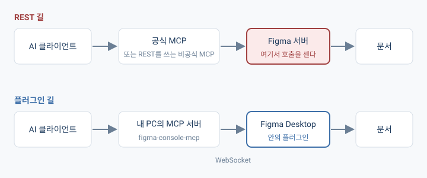

## 개요

도서관 대출 한도는 내 회원증에 걸려 있다. 그래서 친구를 대신 보내 봤자, 내 회원증으로 빌리는 이상 한도는 똑같다.

근데 열람실에 앉아서 그냥 읽는 건? 그건 대출이 아니니까 한도가 없다.

Figma에 둔 기획서를 AI가 읽게 하려다가 이 구조를 그대로 만났다. 누가 요청하는지를 바꿔 봤자 소용이 없었고, 어느 길로 읽는지를 바꿔야 했던 거다.

( 한도 수치와 구조는 2026년 11월에 Figma와 figma-console-mcp 공식 문서에서 확인한 내용이다 )

## 기획서를 Figma에 둔 이유

지난 프로젝트에서는 일정이랑 기획이 자주 엇갈렸다. 어디에 뭐가 적혀 있는지가 흩어져 있다 보니까 헷갈리는 일이 계속 생겼던 거다.

그래서 이번 프로젝트는 기획서를 Figma 파일 하나에 문서로 정리해 두고, 그걸 클라우드에서 AI들이 같이 읽게 하고 싶었다. 그러면 어디서 작업하든 같은 문서를 보고 일관되게 이어 갈 수 있으니까.

그러려면 AI가 Figma를 읽고 쓸 수 있어야 해서 공식 Figma MCP를 붙였는데.. 호출 한도가 생각보다 너무 안 좋았다.

## Starter는 Full seat여도 월 상한이다

내 계정을 조회해 보니까 plan은 `starter`, seat는 `Full`로 나왔다.

한도는 plan이랑 seat를 같이 본다.

| plan | seat | 한도 |
|---|---|---|
| Enterprise | Full / Dev | 하루 600회, 분당 20회 |
| Professional 이상 | Full / Dev | 하루 200회, 분당 10~15회 |
| Education | Full / Dev | Professional과 같다 |
| Starter | 무엇이든 | 월 단위 상한 |

seat가 Full이길래 하루 200회쯤은 되는 줄 알았는데, 그건 Professional 이상일 때 얘기였다. Starter는 seat가 뭐든 간에 월 단위로 묶여 버린다.

( 계정 조회나 새 파일 만들기 같은 몇몇 도구는 한도에서 빠진다 )

## 비공식 MCP도 REST를 타면 같은 한도

그럼 공식 말고 다른 MCP를 쓰면 되는 거 아닌가? 싶었다.

근데 Figma를 다루는 비공식 MCP 중에는 Figma의 REST API를 부르는 것들이 있는데, 이쪽은 Figma REST 한도를 그대로 받는다. 개인 토큰( PAT )을 따로 발급해서 넣어 봐도 막히는 곳은 똑같다. 친구를 대신 보냈는데 회원증은 여전히 내 것인 상황인 거지.

게다가 REST 한도는 **파일이 놓여 있는 plan**을 따라간다. 다른 팀에서 Full seat를 갖고 있더라도 파일이 Starter plan에 있으면 월 상한에 걸린다.

## 플러그인 길로 가면 REST를 안 거친다

다행히 길이 하나 더 있었다. Figma Desktop 안에서 도는 플러그인은 `figma.*` API로 지금 열려 있는 문서를 직접 읽고 고친다. Figma 서버한테 "이 파일 내용 좀 줘"라고 요청하는 게 아니라, 이미 내 PC에 열려 있는 문서를 만지는 거다.



figma-console-mcp가 이 방식을 쓴다. Desktop에 띄워 둔 플러그인이 WebSocket으로 내 PC의 MCP 서버랑 이어지고, AI는 그 서버한테 말을 건다. REST를 안 부르니까 REST 한도에 걸릴 일도 없다. 열람실에 앉아서 읽는 쪽이 이쪽이다.

다만 이 MCP는 플러그인 길이랑 REST 길을 **같이** 쓴다. 도구마다 어느 길로 가는지가 다른데, 그 목록이 문서에 정리돼 있지는 않더라.

## 모드 셋, 토큰이 어디로 가나

figma-console-mcp는 붙이는 방법이 세 가지 있다.

| 모드 | 어디서 도나 | 인증 | 쓰기 |
|---|---|---|---|
| Local | 내 PC | PAT를 내 PC 환경변수로 | 가능 |
| Cloud | 제작사의 원격 서버 | PAT를 그 서버로 보냄 | 가능 |
| Remote | 원격 서버 | OAuth | 불가 |

Remote는 읽기가 REST 길이라서 Starter 한도에 다시 걸려 버린다. Cloud는 설치할 게 없어서 편하긴 한데, 내 Figma 토큰이 남의 서버로 넘어간다는 게 걸렸다.

그래서 Local로 갔다. 토큰이 내 PC 밖으로 안 나가고, 쓸 수 있는 도구도 제일 많다.

## ChatGPT에는 Cloud 모드로 붙였다

Claude Desktop에 붙이는 건 다 끝냈고, 이걸 ChatGPT에도 연결하고 싶었는데 Local 설정 그대로는 안 됐다.

ChatGPT 앱은 인터넷에서 HTTPS로 접근할 수 있는 원격 MCP 서버만 받아 준다. 내 PC 안에서만 도는 Local 서버는 직접 붙일 방법이 없는 거다. 터널을 뚫어서 내 PC의 서버를 인터넷에 내놓으면 되긴 하는데, 그러면 내 Figma 파일을 고칠 수 있는 서버가 문을 활짝 열고 서 있게 된다..

그래서 ChatGPT 쪽만 Cloud 모드로 갔다. 제작사( Southleft )의 원격 서버가 중간에서 이어 주긴 하지만, 문서를 만지는 건 여전히 내 Figma Desktop 안에 떠 있는 플러그인이다. ( ChatGPT 쪽 설정은 PAT 대신 OAuth로 인증하게 돼 있다 )

대신 둘을 짝지어 주는 과정( pairing )이 하나 필요하다. AI가 6자리 코드를 발급해 주면, 5분 안에 Desktop 플러그인에 그 코드를 넣고 Connect를 눌러야 한다. 코드만 받아 놓고 Connect를 안 누르면 연결된 게 아니다.

( 같은 OpenAI 계정으로 쓰는 Codex는 로컬 서버를 받아 줘서, Local 설정을 그대로 등록할 수 있다 )

그러니까 MCP 서버가 어떤 방식으로 말을 주고받느냐에 따라서, 어떤 클라이언트에 어떤 모드로 붙일 수 있는지가 정해지는 거였다.

## "연결됐다"에는 단계가 있었다

Cloud로 붙이는 초반에는 설정을 넣어 놨는데도 대화에 figma-console 쪽 도구가 안 보일 때가 있었다. 그때 AI한테 공식 MCP로 우회하지 말고 이 길만 진단하라고 했고, 진단하는 동안에는 파일이나 레이어를 건드리지 말라고도 해 뒀다.

그러면서 알게 된 게, "연결됐다"가 한 가지 상태가 아니라는 거다.

- 설정에 MCP 서버가 등록돼 있다
- 지금 대화에서 그 서버의 도구를 부를 수 있다
- Figma Desktop의 플러그인이 이어져 있고, 내가 원하는 파일을 보고 있다

앞의 것이 됐다고 뒤의 것까지 된 게 아니더라. 공식 MCP가 응답한다고 해서 이쪽 길이 뚫렸다는 증거가 되는 것도 아니고, 내가 "연결했어"라고 말한 것과 AI가 그 파일을 읽을 수 있는 것도 별개다.

그래서 연결됐는지는 설정 파일이나 인증 성공으로 판단하지 않고, **대상 파일을 한 번 읽어 보는 걸로** 판단하게 했다.

## 끊겼을 때 순서는 Skill로 적어 뒀다

이 확인 순서는 Skill로 적어서 개인 플러그인으로 묶어 뒀다. 적혀 있는 순서는 이렇다.

1. 로컬 도구가 있으면 로컬부터 확인한다. 상태만 보는 게 아니라 플러그인까지 갔다 오는 응답이 오는지 본다.
2. 이어진 파일이 내가 말한 파일이 맞는지 확인한다.
3. 로컬이 멀쩡하면 Cloud 쪽이 끊겨 있어도 그냥 로컬을 쓴다.
4. 로컬이 없거나 응답이 없을 때만 Cloud를 확인하고, 필요하면 다시 짝을 짓는다.
5. 작업 도중에 끊기면 같은 길에서 읽기를 한 번 해 보고 나서 어느 길로 갈지 다시 정한다.
6. 쓰기가 됐는지 안 됐는지 모르겠으면, 다시 쓰기 전에 그 노드부터 읽어 본다.

마지막 6번이 제일 중요한데, 요청은 Figma에 도착해서 적용됐는데 응답만 중간에 사라지는 경우가 있을 수 있기 때문이다. 이때 "실패했나 보다" 하고 똑같은 쓰기를 한 번 더 보내면 프레임이 두 개 생긴다.

참고로 이 플러그인 안에는 Figma를 직접 만지는 코드가 하나도 없다. 읽고 쓰는 건 전부 figma-console-mcp가 하고, 내 플러그인은 어느 도구를 쓸지, 연결이 살아 있는지, 어떤 순서로 할지만 정해 준다. ( 이 순서가 모든 장애 상황에서 검증된 건 아니고, 지금 적어 둔 규칙이 이렇다는 얘기다 )

## 설치 순서

새 환경에서 한 번 더 설치하게 돼서, 다음에 또 찾지 않으려고 적어 둔다.

1. Figma Desktop, Claude Desktop, Node.js 18 이상을 준비한다.
2. Figma → Settings → Security → Personal access tokens에서 토큰을 발급한다. File content, File versions, Library content, Library assets는 Read, Comments는 Read and write, 나머지는 No access.
3. Claude Desktop → Settings → Developer → Edit Config에서 `mcpServers`에 추가한다.

```json
"figma-console": {
  "command": "npx",
  "args": ["-y", "figma-console-mcp@latest"],
  "env": { "FIGMA_ACCESS_TOKEN": "figd_...", "ENABLE_MCP_APPS": "true" }
}
```

4. Claude Desktop을 트레이에서 완전히 끄고 다시 켠다.
5. Figma Desktop → Plugins → Development → Import plugin from manifest에서 `~/.figma-console-mcp/plugin/manifest.json`을 고른다. 경로가 없으면 `npx figma-console-mcp@latest --print-path`로 찾는다.
6. 작업할 파일에서 Figma Desktop Bridge 플러그인을 실행하고 상태가 `Local · ready`인지 본다.
7. 새 대화에서 Figma 연결 상태를 확인해 달라고 한다.

Codex는 한 줄이면 된다.

```bash
codex mcp add figma-console --env FIGMA_ACCESS_TOKEN=figd_... --env ENABLE_MCP_APPS=true -- npx -y figma-console-mcp@latest
```

참고로 토큰은 Figma에서 다시 볼 수가 없다. 새 PC에서는 새로 발급하거나, 기존 설정 파일에 있는 값을 옮겨 와야 한다.

## 소감

공식 MCP 한도가 너무 안 좋아서 시작한 일인데, 알고 보니 "어떤 MCP를 쓰느냐"보다 "그 MCP가 안에서 어느 길로 가느냐"가 문제였다.

지금은 기획서랑 검증 기록이 Figma 파일 하나에 모여 있고, AI가 그걸 읽고 고친다. 지난 프로젝트에서 헷갈렸던 걸 문서 한 곳으로 모아 보려던 게 처음 목적이었으니까, 일단 그 자리는 만들어진 것 같다.
