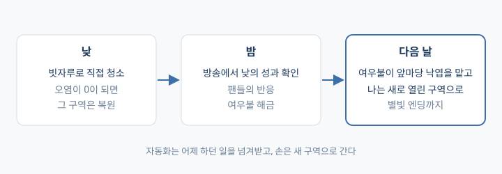
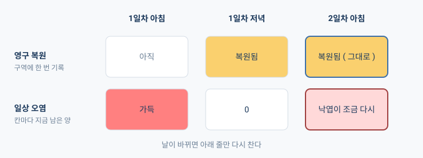

## 개요

지난 프로젝트는 한동안 손을 놓고 있다가 주말에 프로토타입을 몰아서 끝냈는데, 막상 해 보니 재미가 없어서 그대로 접어 버렸다.

멘토님한테 이 얘기를 했더니, 기획에만 매달리다가 정작 얻으려던 건 못 챙기고 급하게 마무리한 것 같다고 하시더라.

그래서 이번에는 뭘 만들지 정하기 전에, 두 줄부터 따로 적어 놓고 시작했다.

- 하고 싶은 것: 재밌게 본 버튜버의 팬게임, 내가 그린 일러스트를 사용한 에셋
- 얻고 싶은 것: 2주 안에 배포되는 결과물, 그리고 내가 직접 짠 코드

그렇게 나온 게 「작은 여우신의 신사 성장기」( 가제 )인데, 여우신이 낡은 신사를 빗자루로 치우고 치운 만큼 신사가 넓어지는 게임이다.

## 좋아했던 장르 말고, 좋았던 경험을 골랐다

처음엔 그냥 좋아하는 게임 얘기부터 했다. 도시 운영 디펜스에서는 미리 준비해 둔 빌드가 먹힐 때가 좋았고, 랜덤 타워 디펜스에서는 뭐가 나올지 모르는데 거기에 맞춰 가는 게 재밌었다.

그렇다고 디펜스를 만들 생각은 없었는데, 얘기가 자꾸 장르 쪽으로 가길래 AI한테 이렇게 말해 뒀다.

> 장르란 게 비슷한 류를 쉽게 이해하기 위한 용도일 뿐이니까 너무 그 시스템에 의존하지 않아도 돼

사실 할 때마다 다른 자동화 빌드가 나오는 로그라이트도 꽤 끌렸다. 근데 그걸 하려면 붙여야 할 게 한두 개가 아니라서 2주짜리에는 도저히 안 맞더라. 그래서 이번에는 신격을 높여 가는 성장 하나만 가져가고, 로그라이트는 나중에 키워 볼 방향으로 남겨 뒀다.

## 자동화는 다음 일로 보내 주는 장치

성장 게임이면 자동화가 빠질 수 없는데, 나는 귀여운 여우신을 직접 움직이는 것도 포기하기 싫었다. 다 자동으로 돌아가 버리면 내가 할 게 없어지니까..

그래서 자동화가 맡는 범위를 "어제 내가 하던 일"까지로 잡았다. 앞마당을 직접 다 치우고 나면 밤에 여우불이 생기고, 다음 날부터는 그 여우불이 앞마당을 맡아 준다. 그럼 나는 새로 열린 구역으로 가면 되는 거다.

여기서 하나 헷갈렸던 게 있는데, "넓은 범위를 한 번에 쓸어 버리는 능력"이랑 "내가 안 눌러도 알아서 치워 주는 자동화"는 서로 다른 시스템이라는 거다. 둘 다 "청소가 편해진다"로 뭉뚱그려 버리면 뭘 만들어야 하는지가 흐려져서, 둘 다 가져가되 역할을 나눠 놓기로 했다.

> 둘 다 가져가도 괜찮지 않을까? 자동화 과정에서 후자가 강점을 보이면 되니까

낮과 밤도 이때 갈렸다. 여우신이면서 방송도 하는 캐릭터니까 낮에는 신사를 가꾸고 밤에는 방송을 하는데, 손이 바쁜 건 낮 쪽이고 밤 방송은 낮에 한 일에 팬들이 반응해 주는 시간으로 뒀다.

## "퍼즐을 깨는 게 메인이 되는 건가?"

팬들이 게임 안에 나오면 좋겠다는 얘기를 하다가, 여우신이 팬의 소원을 들어준다는 설정이 붙었다. 여기까진 좋았는데 AI가 소원마다 풀어야 할 과제를 하나씩 설계하기 시작하더니.. 듣다 보니까 얘가 내 생각이랑 조금 다른 쪽으로 튀는 것 같은 거다.

그래서 일단 멈추고 물어봤다.

> 잠깐 전체 구조를 보았을 때, 퍼즐을 깨는 게 메인이 되는건가?

따지려던 건 아니고, 방향이 달라진 것 같으니까 확인해서 맞춰 두고 싶었다. 얘기해 보니 메인은 여전히 성장과 자동화였고, 소원은 가끔 나오는 인상적인 이벤트 정도로 내려갔다.

소원을 어떻게 다룰지도 이때 같이 정했다. 팬의 부탁을 "이걸 들어주면 나한테 뭐가 이득이지?" 하고 계산하게 만들면 게임으로는 말이 되는데, 팬게임에서 그러는 건 좀 아쉽지 않나 싶었다.

> 팬게임의 의도에 맞춰 누군가의 요청에 효율성을 따지는 건 게임성엔 맞지만 감성을 건드리기에는 아쉬운 구조인거 같아

## 한 번 복원한 곳은 그대로, 낙엽만 다시 쌓인다

직접 하는 조작은 청소로 좁혔다. 신사를 자유롭게 꾸미는 쪽도 생각해 봤는데, 더러운 걸 조금씩 치워 나가는 쪽이 손맛도 낫고 그려야 할 그림도 훨씬 적다.

근데 그러면 문제가 하나 생긴다. 다 치우고 나면 다음 날 여우불이 할 일이 없잖아? 그렇다고 매일 처음부터 다시 더러워지면 어제 한 게 뭐였나 싶어질 거고.

그래서 청소를 두 가지로 나눴다.

- **영구 복원**: 구역을 처음으로 다 치우면 그 구역은 복원된 걸로 남는다. 날이 바뀌어도 안 풀린다.
- **일상 오염**: 낙엽이나 먼지처럼 다음 날 조금씩 다시 쌓이는 것. 이쪽을 여우불이 맡는다.

코드로 가면 이 둘은 저장되는 곳부터 달라진다. "지금 이 구역에 오염이 하나도 없다"는 격자를 세어 보면 나오는 값이고, "이 구역은 복원됐다"는 한 번 적어 두는 사실이거든. 이걸 같은 값으로 써 버리면 다음 날 낙엽 한 장 떨어지는 순간 복원이 풀려 버린다.

구역은 처음부터 다 열어 두지 않고, 복원한 만큼 조금씩 넓어지게 했다. 이쪽이 더 기대되기도 했고!

## 14일 안에 먼저 확인할 것부터 줄 세우기

범위는 이 정도로 잡았다. 구역은 앞마당이랑 참배길 두 곳, 자동화는 여우불 하나, 밤 방송은 짧게, 그리고 마지막에 별빛 엔딩. 처음부터 끝까지 8~15분쯤을 목표로 하고 있는데 아직 재 본 숫자는 아니다.

만드는 순서는 "이게 안 되면 뒤가 다 소용없는 것"부터 앞에 세웠다.

| 단계 | 확인하는 것 |
|---|---|
| G1 | 청소 조작과 피드백. 보상 없이 쓸기만 해도 할 만한가 |
| G2 | 복원, 자동화, 구역 해금이 이어지는가 |
| G3 | 처음부터 엔딩까지 끊기지 않는가 |
| G4 | 다른 사람이 해 봤을 때, 그리고 실행 파일로 돌아가는가 |

일정이 밀리면 뭐부터 줄일지도 미리 정해 뒀다. 연출과 대사가 제일 먼저고, 그다음이 공간 크기와 오염량, 마지막이 방송과 성장 단계다. 여우불까지 빠지게 되면 그건 성장 게임이 아니라 그냥 청소 프로토타입이라고 적기로 했다.

플레이테스트에서 뭘 볼지도 나눠 놨는데, 같은 장면을 보더라도 "조작을 찾았나"랑 "재밌었나"는 봐야 하는 게 다르더라.

| 궁금한 것 | 보는 것 | 안 좋으면 고칠 곳 |
|---|---|---|
| 청소가 할 만한가 | 처음 오염을 줄이기까지 걸린 시간, 끝나고 뭐가 좋았는지 이유까지 말하는가 | 못 찾았으면 안내와 판정, 찾았는데 밋밋했으면 소리·먼지·바닥 변화 |
| 여우불이 체감되는가 | 내가 참배길을 치우는 동안 앞마당 오염이 줄었는가, 다음 날 할 일이 달라졌다고 말하는가 | 안 줄었으면 로직, 눈치를 못 챘으면 피드백, 알았는데 시시했으면 작업량 |
| 방송이 전달되는가 | 낮의 성과와 다음 날 변화를 이어서 설명하는가, 완주 시간 | 성과와 보상의 연결, 시간이 걸린 구간 |

기획서는 Figma 파일 하나에 두고, 캐릭터 스케치나 화면 시안도 같은 파일에 모으기로 했다. 지난 프로젝트에서 일정이랑 기획이 여기저기 흩어져서 헷갈렸던 게 계속 걸렸거든.

## 소감

AI랑 얘기하다 보면 방향이 여러 번 갈리는데, 그때마다 처음에 적어 둔 두 줄로 돌아갔던 것 같다. 로그라이트는 하고 싶은 쪽이었지만 2주 안에는 못 끝낼 것 같아서 미뤘고, 소원 퍼즐은 팬게임다워 보이긴 했는데 그게 메인이 되면 내가 만들려던 게임이 아니었다.

하고 싶은 것과 얻고 싶은 것의 경계를 먼저 그어 두니까 둘 다 어느 정도는 챙기는 기획으로 마무리할 수 있었고, 하려던 걸 다 끝낸 날이라 뿌듯했다!
