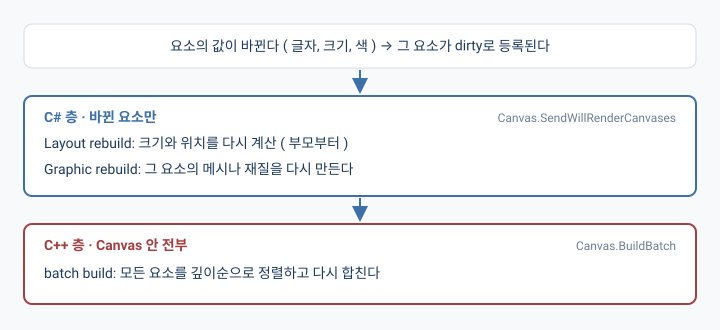
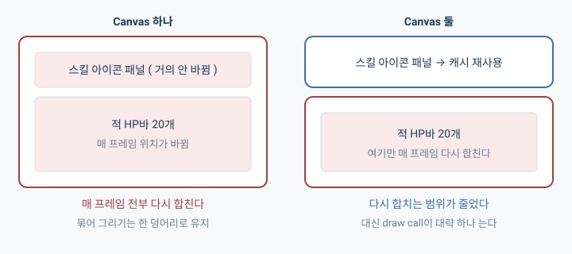

## 개요

단체 사진 찍을 때 한 명이 눈을 감으면 어떻게 되나? 전원이 다시 찍는다.

Unity UI( UGUI )의 Canvas가 이렇게 일한다. HP 숫자 하나가 바뀌었을 뿐인데 옆에서 가만히 있던 스킬 버튼이랑 미니맵 틀까지 같이 다시 찍히는 거다.

그럼 한 명씩 따로 찍으면 되는 거 아닌가? 나도 그렇게 알고 있었다. UI마다 Canvas를 따로 두면 끝인 줄 알았는데, 따로 찍으면 이번엔 셔터를 사람 수만큼 눌러야 하더라..

( Unity Learn의 "Optimizing Unity UI"랑 Unity Support 문서를 읽고 정리한 내용이고, 직접 재 보지는 않았다 )

---

## 1. Canvas는 합친 결과를 재사용한다

화면에 뭔가를 그리려면 CPU가 GPU한테 "이 메시를 이 재질로 그려 줘"라고 명령을 보내야 하는데, 이 명령 한 번을 **draw call**이라고 부른다. UI 요소마다 하나씩 따로 보내면 보낼 준비를 하는 CPU 쪽이 바빠진다.

그래서 같은 재질이랑 텍스처를 쓰는 요소들은 메시를 하나로 합쳐서 한 번에 그리는데, 이게 **batching**이다.

Canvas는 자기 안에 있는 요소들을 이렇게 합쳐서 그리기 명령을 보내 주는 컴포넌트다( 엔진의 C++ 쪽에서 돈다 ). 한 번 합친 결과는 저장해 뒀다가 계속 다시 쓴다. 단체 사진을 한 번 찍어 두고, 아무도 안 움직이면 그 사진을 그냥 계속 쓰는 거랑 비슷하다.

## 2. 하나가 바뀌면 안 바뀐 것까지 다시 본다

Canvas 안의 뭔가가 바뀌어서 합쳐 둔 결과를 더는 못 쓰게 된 상태를 **dirty**라고 한다.

문제는 다시 합칠 때인데, 요소 하나만 바뀌었어도 Canvas는 자기 안에 있는 요소를 전부 다시 본다. 깊이순으로 줄을 세우고, 뭐가 뭐랑 겹치는지, 어떤 것끼리 재질이 같은지를 다 확인한 다음에야 다시 합친다.

HUD를 Canvas 하나에 다 넣었다고 해 보자. 배경 패널, 스킬 버튼 8개, 미니맵 틀, HP 텍스트가 같이 들어 있는데 HP가 100에서 97로 바뀌면? 나머지도 전부 다시 줄 서서 합쳐진다. 눈 감은 건 한 명인데 전원 재촬영인 거지.

## 3. rebuild는 두 층이다

지금까지 "다시 만든다"라고 뭉뚱그려 말했는데, 안에서는 두 단계가 따로 돌고 있다.

**첫째 층( C# )** 은 바뀐 요소만 다룬다.

- Layout rebuild: 크기랑 위치를 다시 계산한다. 계층이 얕은 것, 그러니까 부모부터 한다.
- Graphic rebuild: 크기가 바뀌었으면 그 요소의 메시를 다시 만들고, 재질이나 텍스처가 바뀌었으면 재질을 갱신한다.

**둘째 층( C++ )** 은 Canvas 안에 있는 걸 전부 다시 정렬하고 합친다. 멀티코어 기기에서는 여러 스레드로 나눠서 돈다고 한다.

Profiler에서 보면 첫째 층은 `Canvas.SendWillRenderCanvases`, 둘째 층은 `Canvas.BuildBatch`로 잡힌다. 근데 이 항목들이 UI, Others, Rendering 같은 서로 다른 카테고리에 흩어져서 잡힐 수 있어서, 카테고리 필터를 걸어 놓고 보면 일부를 놓칠 수 있다.

## 4. 위치만 옮겨도 공짜가 아니다

크기는 그대로 두고 위치만 옮기면 메시를 다시 만들 필요가 없다. 그래서 "위치 이동은 비용이 거의 없구나" 하고 넘어가기 쉬운데, 사실 이때 피한 건 첫째 층뿐이다.

합쳐 놓은 덩어리 안에서 그 요소의 꼭짓점 위치는 바뀌었고, 뭐랑 겹치는지도 달라졌을 수 있다. 그러니 둘째 층은 다시 돌아야 하고, 둘째 층은 같은 Canvas에 가만히 있던 요소까지 전부 다시 본다.

사진으로 치면 옷을 갈아입은 사람은 없는데 한 명이 자리를 옮긴 상황이다. 분장은 다시 안 해도 되지만 사진은 어쨌든 다시 찍어야 한다.

## 5. 나누면 draw call이 는다

Canvas는 하나하나가 서로 격리돼 있다. Canvas 안에 넣은 하위 Canvas도 마찬가지라서, 자식이 dirty해져도 부모는 다시 안 만들고 반대도 그렇다( 부모가 바뀌면서 자식 크기까지 달라지는 경우는 빼고 ).

그러니까 자주 바뀌는 것과 안 바뀌는 것을 서로 다른 Canvas에 두면 되는 거다.

적 HP바 20개가 매 프레임 적을 따라 움직이고 있고, 스킬 아이콘 패널은 거의 안 바뀐다고 해 보자. 둘이 한 Canvas에 있으면 스킬 패널까지 매 프레임 다시 합쳐지는데, HP바를 별도 Canvas로 빼 주면 스킬 패널은 저장해 둔 결과를 계속 쓸 수 있다.

근데 이게 공짜는 아니다. Canvas끼리는 합쳐서 그리지 않기 때문에 나눌 때마다 draw call이 늘 수 있다. 사진을 두 장으로 나눠 찍으면 눈 감은 쪽만 다시 찍으면 되긴 하는데, 셔터는 두 번 눌러야 하는 것처럼.

그래서 나누는 기준은 **얼마나 자주 바뀌는가**가 된다. 안 바뀌는 것끼리 한 Canvas, 자주 바뀌는 것끼리 한 Canvas, 같이 바뀌는 것들은 같은 Canvas에. "어떻게 바뀌는가"( 위치냐 크기냐 )로 나누지 않는 이유는 4절에서 본 대로다.

둘째 층이 여러 스레드로 돌게 된 뒤로는( Unity 5.2 ) 예전만큼 잘게 나눌 필요는 줄었다고 한다. 대신 비용이 코어 수를 따라가게 돼서, 코어가 적은 모바일 기기일수록 더 아프다.

## 6. 숨길 때: SetActive와 Canvas.enabled

UI를 껐다 켜는 방법도 두 가지가 꽤 다르게 동작한다.

| | `GameObject.SetActive(false)` | `Canvas.enabled = false` |
|---|---|---|
| 합쳐 둔 결과 | 버린다 | 메모리에 남긴다 |
| 다시 켤 때 | 처음부터 다시 만들고 합친다 | 그대로 쓴다 |
| 스크립트 `Update` | 멈춘다 | 계속 돈다 |

자주 여닫는 창이라면 `Canvas.enabled` 쪽이 켜는 순간에 덜 끊긴다. 대신 안 보이는 동안에도 `Update`가 계속 돌고 있으니까 그건 따로 막아 줘야 한다.

같이 알아 두면 좋은 것도 두 가지 있다.

- 부모를 바꾸거나 형제 순서를 바꾸면 그 요소랑 자식들이 dirty가 된다.
- Layout Group은 dirty가 될 때마다 자식들의 크기와 위치를 다시 계산해서 비싸다. 작고 고정된 배치라면 앵커로 대신할 수 있다.

## 소감

사실 AI가 학습 주제로 추천해 줘서 보게 된 내용이다.

그냥 UI마다 Canvas를 따로 두면 되는 줄 알았는데, 어떻게 그려지는지를 알아야 하고 나눌지 말지도 성능을 놓고 판단해야 하는 지점이 있다는 건 이번에 처음 알았다!

## 더 읽어볼 만한 것들

- [Optimizing Unity UI ( Unity Learn )](https://learn.unity.com/tutorial/optimizing-unity-ui)
- [Split canvas for dynamic objects ( Unity Support )](https://support.unity.com/hc/en-us/articles/115000355466-Split-canvas-for-dynamic-objects)
- [Unity UI optimization tips](https://unity.com/en/how-to/unity-ui-optimization-tips)
