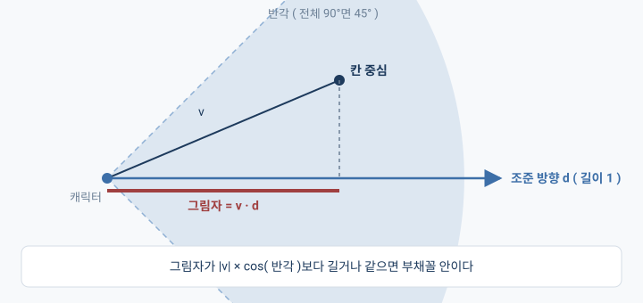
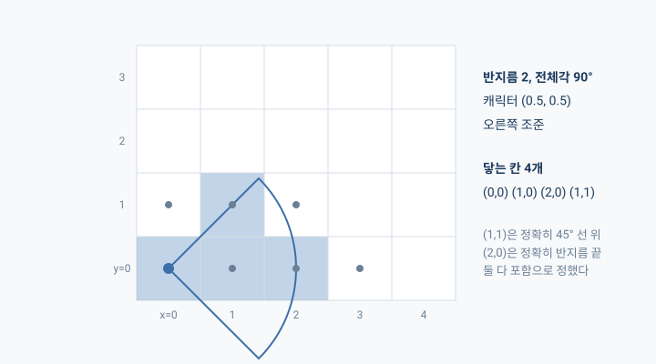
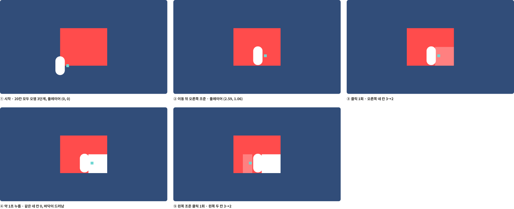

## 개요

지난 프로젝트에서는 구현을 거의 AI한테 맡기고 나는 검증만 했다. 실무에서 AI를 쓰게 되면 어차피 구현은 맡기고 리뷰만 하게 되지 않을까? 싶어서 그렇게 해 본 건데, 빠르긴 했어도 끝나고 보니 나한테 남은 게 없는 느낌이더라.

그래서 이번 팬게임에서는 규칙을 하나 걸었다. 게임 규칙이 들어가는 코드는 내가 직접 쓰고, AI랑은 설계를 놓고 토론만 하기로.

그랬더니 빗자루 한 번 휘두르는 판정 하나 만드는 데 오후가 통째로 들어갔다..

「작은 여우신의 신사 성장기」는 여우신이 빗자루로 낡은 신사를 치워 나가는 2D 게임인데, 그중에 제일 먼저 만든 게 바닥의 오염이 빗자루질에 한 단계씩 줄어드는 부분이다. ( Unity 6000.3, C# )

## 이번엔 Core를 내가 쓴다

코드는 세 덩어리로 나눠 놨다.

- **Core**: 게임 규칙. Unity를 전혀 모르는 순수 C#
- **Presentation**: 화면과 입력. Core의 값을 읽어서 그리기만 한다
- **Tests**: Core를 화면 없이 검사하는 Edit Mode 테스트

이 중에 Core랑 Tests는 내가 직접 쓰고, AI는 뼈대랑 힌트, 리뷰만 주기로 했다.

Core는 Unity를 아예 못 쓰게 막아 놨기 때문에 `Vector2`도 `Mathf`도 없다. 좌표는 `float x, y`로 따로따로 받아야 하고 수학 함수는 `System.Math`를 써야 해서 좀 불편하긴 한데, 그 덕분에 플레이 버튼을 안 눌러도 규칙이 맞는지 바로 확인할 수 있다.

## 오염 격자: 받은 배열은 복사해서 갖는다

바닥은 칸으로 나뉘어 있고, 칸마다 오염이 0~3으로 들어 있다. `DirtGrid`의 첫 버전은 이게 전부였다.

```csharp
public class DirtGrid
{
    private readonly int[,] _cells;

    public int Width { get; }
    public int Height { get; }

    public DirtGrid(int[,] initial)
    {
        // 가로, 세로 입력 크기 확인
        Width = initial.GetLength(0);
        Height = initial.GetLength(1);
        // 보드 크기 적용
        _cells = new int[Width, Height];

        for (int x = 0; x < Width; ++x)
        {
            for (int y = 0; y < Height; ++y)
            {
                int value = initial[x, y];
                // 초기 값 검사
                if (0 > value || value > 3)
                {
                    // 검사 실패 시 예외 던지기
                    throw new System.ArgumentException();
                }

                _cells[x, y] = value;
            }
        }
    }
}
```

C# 구조를 오랜만에 만지는 거라, 생성자랑 필드, 속성이 각각 뭘 하는 자리인지부터 다시 짚고 시작했다.

여기서 하나 배운 게 `readonly`가 생각보다 막아 주는 게 별로 없다는 거다. `private readonly int[,] _cells`라고 써 두면 `_cells`에 다른 배열을 다시 넣는 것만 막아 주고, 배열 안에 든 값은 얼마든지 바뀔 수 있다. 그러니까 받은 배열을 그대로 들고 있으면, 격자를 만든 쪽에서 나중에 자기 배열을 고칠 때 내 격자도 같이 바뀌어 버리는 거지.

그걸 막아 주는 건 `new int[Width, Height]`로 새 배열을 만들어서 값을 하나씩 옮겨 담는 부분이었다.

테스트는 두 개를 썼다.

- 오염이 3인 칸을 네 번 청소하면서 매번 `2 → 1 → 0 → 0`이 맞는지 본다. 마지막 값만 보면 한 번에 0이 돼 버리는 구현도 통과해 버리니까.
- 격자를 만든 다음에 원래 배열의 한 칸을 3에서 0으로 바꿔 보고, 격자 안의 값은 여전히 3인지 본다.

## 힌트가 내 눈높이를 지나쳤을 때

화면 쪽으로 넘어가면서 한 번 막혔다.

AI가 준 힌트가 아직 만들지도 않은 도우미 메서드를 이미 있는 것처럼 깔고 얘기하고 있었고, 나는 `Sprite`가 뭔지, 뭘 만들어서 어디에 넣어야 하는 건지도 모르는데 일단 빈칸부터 채워 보라는 식이었다.

내가 지금 어디를 보고 있는지를 AI가 못 따라오는 것 같아서, 이 부분이 불편하다고 그대로 얘기했다. 그러고 나서부터는 뭘 먼저 만들어야 하는지 순서랑 구조를 그림으로 먼저 보여 준 다음에 힌트를 줘서, 따라가기가 훨씬 편해졌다.

## 내적은 얼마나 같은 방향을 보는지 묻는다

빗자루가 쓰는 범위는 부채꼴 모양이다. 캐릭터 중심에서 마우스 쪽으로 반지름 2, 전체 각도 90°로 펼쳐지는데, 칸의 중심이 이 안에 들어오면 그 칸이 한 단계 닦인다.

안에 들어왔는지는 두 가지를 보면 된다. 칸 중심에서 캐릭터 위치를 뺀 걸 `v`라고 했을 때,

- **거리**: `v`의 길이가 반지름 이하인가?
- **각도**: `v`가 조준 방향에서 반각( 45° ) 안쪽에 있는가?

거리는 쉬운데 각도가 문제였다. 각도를 직접 구할 줄 알았는데, 그러지 않고 내적으로 넘어가더라.



솔직히 처음엔 AI가 알려 준 식을 그대로 옮겨 적기만 했다. 다 쓰고 나서 보니까 내가 지금 뭘 계산한 건지를 모르겠어서 다시 물어봤고..

> 다 작성했는데 내적을 어떻게 계산한건지 니가 알려준대로 짜기만해서 조금 이해시켜줄래?

설명을 듣고 내가 이해한 건 이 정도다. 내적은 두 방향이 **얼마나 같은 쪽을 보고 있는지**를 확인하는 수단이라는 것. 조준 방향 `d`의 길이가 1이면 `v`와 `d`의 내적은 `v`가 조준 방향으로 나아간 만큼( 그림에서 그림자 길이 )이 되는데, 완전히 같은 쪽을 보면 `v`의 길이가 그대로 나오고, 직각이면 0, 반대쪽이면 음수가 나온다.

그럼 정확히 반각만큼 벌어졌을 때의 그림자는 `|v| × cos(반각)`일 테니까, 그림자가 이것보다 길면 반각보다 덜 벌어진 거고 부채꼴 안에 있다는 얘기가 된다.

```csharp
public bool Contains(int cellX, int cellY, float originX, float originY, float dirX, float dirY)
{
    // 단위 길이가 기준선 초과 시 예외처리
    float dirDistSQ = dirX * dirX + dirY * dirY;
    if (Math.Abs(1 - dirDistSQ) > Tolerance)
    {
        throw new System.ArgumentOutOfRangeException();
    }
    // 기준 점 중앙
    float centerX = cellX + 0.5f;
    float centerY = cellY + 0.5f;
    // 상대 거리 계산
    float vx = centerX - originX;
    float vy = centerY - originY;
    // 거리 검사
    float distSq = vx * vx + vy * vy;
    // 반지름 범위 외 false
    if (distSq > _squareRadius)
        return false;
    // 원점과 가까운 경우 true
    if (distSq < Tolerance)
        return true;

    // 내적 결과 반환
    float dot = vx * dirX + vy * dirY;
    // 내적과 기준선(거리 비율 * cos(반각)) 비교
    return dot >= (float)Math.Sqrt(distSq) * _cosHalfAngle - Tolerance;
}
```

반지름의 제곱이랑 `cos(반각)`은 생성자에서 한 번만 계산해서 들고 있고, 거리 비교는 제곱끼리 해서 제곱근을 안 쓰게 했다.

그럼 전체 각도를 360°로 주면 어떻게 될까? 라는 질문도 받았는데, 반각이 180°면 `cos`이 -1이라 기준선이 음수로 내려가 버린다. 그림자는 아무리 반대쪽을 봐도 `-|v|`까지밖에 안 내려가니까 반지름 안에 있는 칸은 전부 걸리게 되고, 원 판정을 따로 안 만들어도 되는 거다.

## 경계는 코드보다 먼저 정했다

선 위에 정확히 걸친 칸을 넣을지 뺄지는 코드를 쓰기 전에 먼저 정해 놓고, 그대로 테스트에 옮겨 적었다.

| 걸친 경우 | 정한 것 |
|---|---|
| 칸 중심이 캐릭터 위치와 같다 | 포함 |
| 거리가 정확히 반지름 | 포함 |
| 각도가 정확히 반각 | 포함, 오차는 `0.0001`만큼 봐준다 |
| 조준 방향의 길이가 1이 아니다 | 예외. 넘기는 쪽 책임 |

방향 길이 검사를 맨 앞에 둔 데는 이유가 있다. 잘못된 방향이 들어왔는데 마침 거리가 멀어서 `false`로 조용히 넘어가 버리면 나중에 찾기가 힘들거든. 그리고 길이는 `== 1`로 비교하면 안 되는 게, 정규화한 벡터도 `0.99999994` 같은 값이 나온다.

테스트로 고정해 둔 예시가 이건데, 5×4 격자에서 캐릭터가 `(0.5, 0.5)`에 서서 오른쪽을 보고 있는 상황이다.



범위 청소 자체는 `DirtGrid` 쪽에 넣었다. 칸의 값을 바꾸는 건 격자만 하고, 부채꼴은 "들어왔나?"만 대답해 주는 식이다. 돌려주는 값은 이번에 줄어든 칸 수라서 네 번 부르면 `4, 4, 4, 0`이 나오는데, 이러면 닿긴 했지만 닦을 게 없었던 경우랑 진짜 닦인 경우를 나중에 구분할 수 있다.

## 누른 순간 한 번, 누르고 있으면 0.4초마다

입력은 왼쪽 클릭 하나다. 누른 순간에 바로 한 번 쓸고, 계속 누르고 있으면 0.4초마다 반복한다.

```csharp
if (ms.leftButton.wasPressedThisFrame)
{
    // 누른 순간: 즉시 1회, 타이머 초기화
    CleanOnce();
    _holdTimer = 0f;
}
else if (ms.leftButton.isPressed)
{
    // 타이머에 이번 프레임 시간 추가
    _holdTimer += Time.deltaTime;

    // 간격을 넘었으면 1회 청소, 넘은 만큼은 다음으로 이월
    if (_holdTimer >= _repeatInterval)
    {
        CleanOnce();
        // 타이머에서 간격만큼 뺌 (0으로 초기화하지 않음)
        _holdTimer -= _repeatInterval;
    }
}
```

누른 프레임에는 `wasPressedThisFrame`이랑 `isPressed`가 둘 다 참이라서, `else if`로 묶어 두지 않으면 한 번 눌렀는데 두 번 쓸어 버린다.

타이머도 0으로 되돌리는 게 아니라 간격만큼만 뺀다. 0.41초에 걸렸으면 남은 0.01초를 다음 회차로 넘겨 주는 건데, 이렇게 해야 프레임이 좀 느려져도 간격이 조금씩 밀리지 않는다.

화면은 칸마다 바닥이랑 오염을 따로 그려 놨다. 오염이 0이 되면 오염 쪽만 꺼지고 그 아래에 있던 바닥이 드러나는 식이다.



( 위 화면은 AI가 Unity를 직접 조작해서 입력을 넣고 찍은 검증 기록이고, 테스트 9건 통과도 같이 확인됐다 )

내가 직접 눌러 봤을 때도 빨간 칸이 한 단계씩 옅어지다가 바닥이 나왔는데,

오 이게 되네 ㅋ

## 소감

오전에는 알고리즘 공부를 하고 오후는 거의 이 프로젝트에 다 썼는데, 꽤 알차게 보낸 날이었다.

지난번처럼 AI한테 맡겼으면 금방 끝났을 분량이긴 하다. 그래도 이번에는 `readonly`가 뭘 안 막아 주는지, 내적이 뭘 물어보는 계산인지, 경계에 걸친 칸을 넣을지 뺄지 같은 걸 내가 직접 정했다. 더 많이 얻어 가 보려고 고른 방식인데, 적어도 이 셋은 남은 것 같다.
