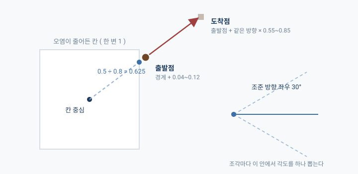
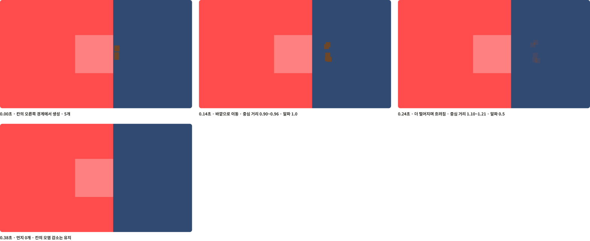
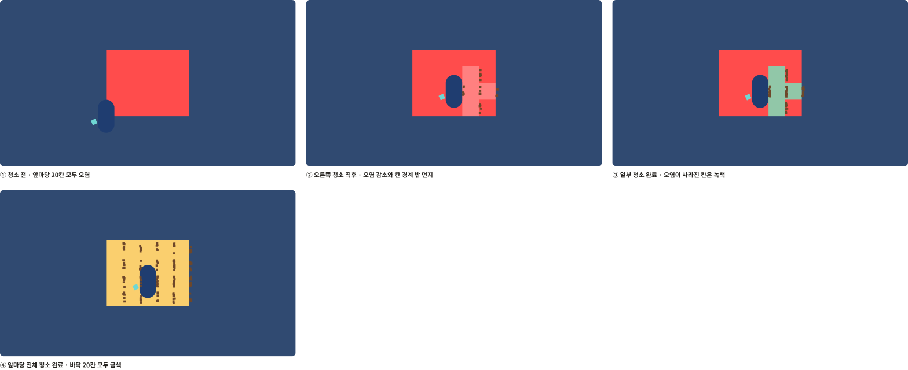
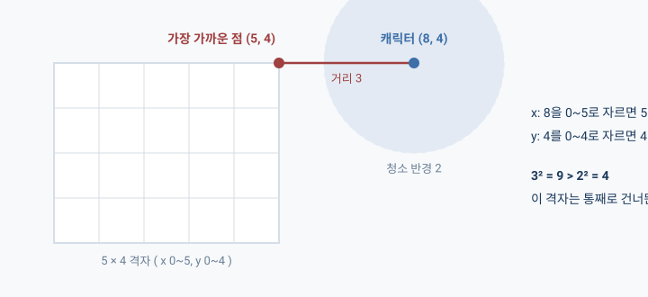
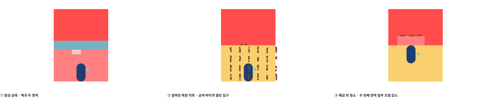

## 개요

빗자루질을 열심히 했는데 먼지가 제자리에서만 맴돌고 있으면, 뭔가 쓴 것 같지가 않다.

처음 붙인 먼지 효과가 그랬다. 칸 안에서 생겨서 칸 안에서 사라져 버리니까, 오염은 분명히 줄었는데도 치웠다는 느낌이 영 안 나는 거다.

「작은 여우신의 신사 성장기」는 여우신이 빗자루로 낡은 신사를 치워 나가는 2D 게임이다. 지난번에 빗자루가 닿은 칸의 오염이 줄어드는 데까지는 만들어 놨고, 이번에는 그게 "쓸렸다"로 보이게 하는 것, 그리고 앞마당을 다 치우면 다음 구역이 열리는 것까지 붙여 봤다. ( Unity 6000.3, C# )

## 그림이 없는데 손맛을 어떻게 보나

먼지 얘기를 하기 전에, 사실 하루를 통째로 못 건드린 날이 있었다.

다음 할 일이 "청소 피드백 마무리"였는데 프로젝트에 그림이 하나도 없었다. 캐릭터는 파란 캡슐이고 바닥은 색칠한 사각형인데, 이 상태로 손맛을 확인하라는 게 말이 되나 싶었던 거다.

> 팬 게임 특성상 기능만 있으면 아무 의미없다 생각하기도 하고, 애니메이션이나 상태 기능을 구현하려면 최소한의 애니메이션 및 에셋이 필요하다고 생각해

그래서 다음 날은 AI랑 일정부터 다시 봤는데, 이때 보는 기준을 하나 바꿨다.

> 나의 가용 시간보다 프로젝트 마감 기한을 중심으로 오늘까지 해야할 일을 정리해야해.

"오늘 몇 시간 쓸 수 있지?"로 보면 할 수 있는 것만 눈에 들어오는데, 마감일부터 거꾸로 세어 보면 이미 밀린 것과 오늘 당장 시작해야 하는 게 먼저 보인다. 그렇게 다시 보니까 그림 작업은 어느 단계에도 시간이 안 잡혀 있더라..

캐릭터를 어떻게 움직일지도 여기서 정했다. 그림 한 장을 머리, 몸, 팔로 잘라서 돌리는 방식( 컷아웃 )을 제안받았는데 그게 좀 걸렸다.

> 구체적으로 그림을 파츠별로 구성해서 움직이게 하면 어색함이 느껴지지 않을까?

잘라 붙인 그림이 뻣뻣해 보이는 건 모든 부위가 같은 순간에 같이 도착하고, 형태가 눌리거나 늘어나지 않아서 그렇다고 한다. 게다가 동작이 대기, 걷기, 쓸기 세 개뿐이라 잘라 쓰는 이점도 별로 없었다. 그래서 포즈를 다섯 장( 대기 1, 걷기 2, 쓸기 2 ) 그려서 갈아 끼우고, 흔들리거나 늘어나는 건 코드로 더하기로 했다.

그리고 코드가 그림을 기다리지 않아도 되게 순서를 바꿨다. 그림보다 규격( 캔버스 크기, 기준점, 파일 이름 )을 먼저 정해 두고, 같은 규격의 단색 도형으로 동작을 다 끝낸 다음에 그림만 갈아 끼우는 식이다. 그러니까 청소 피드백도 일단 단색으로 끝내면 되는 거였다.

## 줄어든 칸에서만 먼지가 난다

청소 규칙은 "이번에 몇 칸이 줄었는지"만 돌려준다. 근데 먼지를 띄우려면 몇 칸인지가 아니라 어느 칸인지를 알아야 한다.

그래서 화면 쪽에 "마지막으로 그린 오염값"을 칸마다 적어 두고, 다시 그릴 때 지금 값이랑 비교해서 줄어든 칸에서만 먼지를 시작하게 했다.

```csharp
// 현재 칸 오염도 확인
int dirt = Model.GetDirt(x, y);
var dirtRenderer = _dirtRenderers[x, y];
// 이전과 비교해서 소모된 경우 = 청소된 경우
if (dirt < _displayedDirt[x, y])
    // 먼지 조각 애니메이션 재생
    StartCoroutine(ScatterDust(dirtRenderer.transform.localPosition, sweepAngleDegrees));

// 오염도 갱신
_displayedDirt[x, y] = dirt;
```

비교를 먼저 하고 나서 적어 둔 값을 고쳐야 한다. 순서가 바뀌면 비교하는 시점에 이미 같은 값이 돼 있어서 먼지가 한 번도 안 난다.

## 먼지가 칸 안에서만 놀았다

첫 버전을 직접 해 보고 한 말이 이거다.

> 플레이 했을 때 먼지가 바닥 바깥으로 퍼지는 느낌이 있어야 하는데 내부에서 내부로만 가는 듯한 느낌이 커

먼지가 캐릭터 몸 쪽에 뭉쳐 있고 칸 밖으로는 나가질 않았다. 그럼 출발점만 칸 밖으로 옮기면 되지 않나? 싶었는데 그걸로는 안 됐다. 도착점을 칸 중심에서 잰 거리로 정하고 있었기 때문에, 출발점이 밖으로 나갈수록 먼지가 움직이는 거리는 오히려 짧아졌던 거다.

그래서 규칙을 아예 다시 정했다.

> 그냥 확실하게 할게. 시작 위치만 플레이어 방향에 맞춰 방사형으로 시작하고, 흩어지는 방향은 칸의 중심을 기준으로 바깥쪽으로 퍼지게 진행해. 최대한 직관적이고 간결하게



먼지 조각 하나마다 이런 순서로 정한다.

1. 조준 방향 좌우 30° 안에서 각도를 하나 뽑는다.
2. 칸 중심에서 그 방향으로 가다가 처음 만나는 변까지의 거리를 구한다.
3. 거기서 `0.04~0.12`만큼 더 나간 곳이 출발점이다.
4. 출발점에서 같은 방향으로 `0.55~0.85`만큼 더 간 곳이 도착점이다.

이 중에 2번이 조금 재밌었는데, 한 변이 1인 정사각형이면 방향의 가로·세로 성분 중에 큰 쪽으로 `0.5`를 나누기만 하면 된다. 방향이 `(0.8, 0.6)`이라면 가로 쪽이 먼저 벽에 닿으니까 `0.5 ÷ 0.8 = 0.625`가 나오는 식이다.

```csharp
// 범위 내 랜덤 각도 계산
float angleDegrees = Random.Range(minAngleDegrees, maxAngleDegrees);
float angleRadians = angleDegrees * Mathf.Deg2Rad;
// 시작 방향 추출
var directionToStart = new Vector3(Mathf.Cos(angleRadians), Mathf.Sin(angleRadians), 0f);

// 시작 위치 계산용, 처음 만나는 칸 경계 거리 계산
float fastestAxis = Mathf.Max(Mathf.Abs(directionToStart.x), Mathf.Abs(directionToStart.y));
float distanceToEdge = CellHalfSize / fastestAxis;
// 최소 위치 + 랜덤 부여
float startDistance = distanceToEdge + Random.Range(minStartOffset, maxStartOffset);
Vector3 startPosition = directionToStart * startDistance;

// 거리 랜덤 계산
float travelDistance = Random.Range(minTravelDistance, maxTravelDistance);
// 시작, 도착지점 설정
startPositions[i] = startPosition;
endPositions[i] = startPosition + directionToStart * travelDistance;
```

두 점은 조각을 만들 때 한 번만 정하고, 그 뒤로는 코루틴이 매 프레임 `지난 시간 ÷ 전체 시간`으로 두 점 사이 어디쯤인지를 잡아 준다. 앞 절반은 또렷하게 두고 뒤 절반에서 흐려지게 했는데, 처음부터 흐려지면 어느 쪽으로 가는지가 잘 안 보여서다.



( AI가 Unity를 직접 조작해서 같은 먼지 묶음을 시간대별로 찍은 기록이고, 시간은 게임 안 시간이다 )

고친 버전을 다시 해 봤는데.. 엄청 좋다거나 재밌다는 건 아니고, 전보다는 낫고 어색하지는 않은 정도다.

## 바닥색 세 갈래는 세 갈래로 쓴다

칸의 오염이 0이 되면 그 칸 바닥을 녹색으로 바꾸고, 앞마당 전체가 0이 되면 전부 금색으로 칠해 준다.



처음 코드는 이렇게 생겼었다.

```csharp
floor.color = allClean ? RestoredFloorColor : UncleanFloorColor;
if (!allClean && _displayedDirt[x, y] == 0)
    floor.color = CleanFloorColor;
```

돌아가긴 하는데 읽을 때마다 뭔가 어색해서 AI한테 제대로 설명해 달라고 했다. 들어 보니 첫 줄에서 색이 다 정해진 것처럼 보이는데 바로 다음 줄이 같은 칸을 덮어쓸 수 있다는 거였고, 경우는 셋인데 코드는 "둘 중 하나, 그리고 예외 하나"처럼 쓰여 있었던 거다.

```csharp
// 전체 청소 완료
if (Model.IsRestored)
    floor.color = RestoredFloorColor;
// 그 칸만 청소된 경우
else if (_displayedDirt[x, y] == 0)
    floor.color = CleanFloorColor;
// 더러운 바닥
else
    floor.color = UncleanFloorColor;
```

줄 수는 늘었는데 경우가 셋이라는 게 한눈에 보인다. 이걸 보고 나서 AI한테 기준을 하나 줬다.

> 앞으로 코드 작성할 때 성능적 이점이 크지 않다면 최대한 직관적으로 작성해

## 다 치우면 옆 구역이 열린다

앞마당을 다 치우면 참배길로 가는 벽이 사라진다.

여기서 "지금 오염이 0이다"랑 "복원됐다"를 따로 뒀다. 나중에 날이 바뀌면 앞마당에 낙엽이 다시 쌓일 텐데, 그때 복원이 같이 풀려 버리면 열렸던 벽이 다시 닫히잖아? 그래서 격자에 `IsRestored`를 하나 두고, 마지막 오염이 빠지는 순간에 한 번만 켜 준다. 다시 끄는 코드는 아예 없다.

```csharp
// 하나 이상이 청소되고, 전체 셀이 깨끗한 경우
if (reduced > 0 && !_cells.Cast<int>().Any(dirt => dirt > 0))
{
    IsRestored = true;
}
```

구역을 어떻게 엮을지는 내 쪽에서 방향을 냈다. 구역이 하나 늘 때마다 플레이어 코드에 격자 변수랑 `if`가 하나씩 붙는 구조가 싫었거든.

> 플레이어가 영역에 들어서면 그 영역과 주위 영역 청소에 대한 참조를 받는 것처럼 설계하는게 맞는거 같아

지금 구현에서는 플레이어가 맵한테 "여기서 이 방향으로 쓸었어"만 넘겨준다. 맵은 구역 목록을 들고 있고 구역마다 "먼저 복원돼야 하는 구역"이 하나씩 적혀 있는데, 이게 비어 있으면 처음부터 열려 있는 구역이다.

```csharp
private bool IsOpen(Region region)
{
    // 지역이 해금되었는지 확인
    var prerequisite = region.RestoreFirst;
    return prerequisite == null || prerequisite.Model?.IsRestored == true;
}
```

벽도 청소도 똑같이 이 `IsOpen`한테 물어보니까, 해금 규칙은 한 군데에만 있으면 된다.

## 멀리 있는 격자는 통째로 건너뛴다

구역이 여러 개가 되면 한 번 쓸 때마다 모든 구역의 모든 칸을 검사하게 된다. 그 전에 "이 구역에 빗자루가 닿기는 하나?"부터 걸러 주고 싶었다.

방법은 생각보다 간단한데, 캐릭터 위치의 x를 `0~가로`, y를 `0~세로` 안으로 각각 잘라 넣으면 그 격자에서 캐릭터랑 가장 가까운 점이 나온다. 격자 안에 서 있으면 자기 자신이 나오고, 밖에 있으면 가장 가까운 변이나 꼭짓점이 나오는 거다.



그 점까지의 거리가 청소 반경보다 멀면, 그 구역은 칸 검사를 아예 안 하고 넘어간다.

```csharp
// 시작점에서 격자의 가장 가까운 점 계산
Vector2 localOrigin = grid.transform.InverseTransformPoint(origin);
var nearest = new Vector2(
    Mathf.Clamp(localOrigin.x, 0f, grid.Model.Width),
    Mathf.Clamp(localOrigin.y, 0f, grid.Model.Height));
// 가장 가까운 점과의 거리와 청소 반경 검사
if ((nearest - localOrigin).sqrMagnitude > radiusSquared) continue;
```

그리고 닿는 구역을 먼저 다 골라 놓은 다음에 청소를 시작한다. 그래서 한 번 휘둘러서 앞마당이 복원되더라도 그 휘두르기로 참배길까지 같이 닦이지는 않고, 참배길은 다음 휘두르기부터 닦인다.



직접 해 봤을 때도 입구가 열리고, 넘어가서 청소되는 것까지 잘 됐다. ( 위 화면은 같은 걸 AI가 다시 돌려서 찍은 기록 )

## 소감

전날은 집에 오니 시간도 늦었고, 그림도 없는데 뭘 확인하라는 건지 싶어서 프로젝트를 열지도 못했다.

근데 막상 마감일 기준으로 다시 세어 보니까, 고민해야 했던 건 "그림이 없다"가 아니라 "그림에 시간이 아예 안 잡혀 있다" 쪽이었다. 그래서 그림은 다섯 장으로 정해 두고 피드백은 단색 도형으로 먼저 끝냈다.

먼지는 아직 재밌다고 할 정도는 아닌데, 그래도 어색하지 않은 데까지는 왔고 다 치우면 문이 열리는 것까지 하루에 붙였으니 이 정도면 괜찮은 것 같다.
