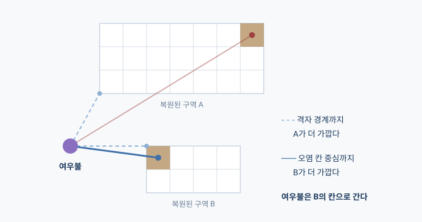
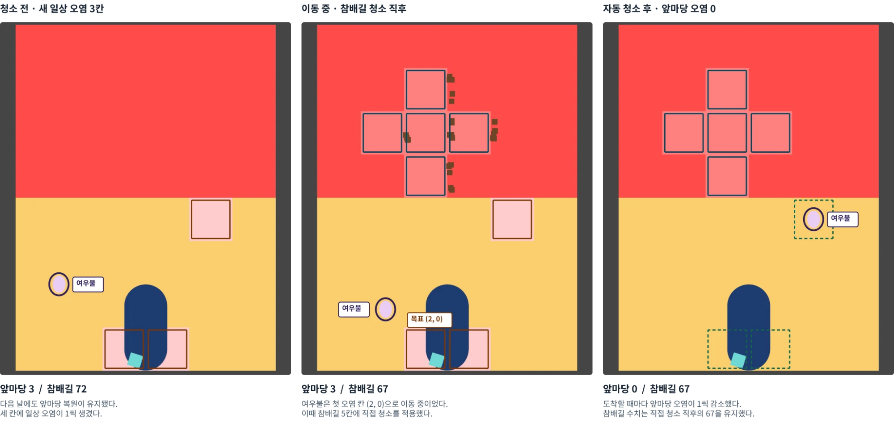

## 개요

지금까지 이 게임에서 움직이는 건 내가 조종하는 여우신 하나뿐이었다. 손을 놓으면 신사도 그대로 멈춰 있었는데, 이번에는 아무것도 안 눌렀는데도 보라색 동그라미 하나가 오염 칸으로 날아가서 바닥을 닦고 있었다.

「작은 여우신의 신사 성장기」는 여우신이 빗자루로 낡은 신사를 치워 나가는 2D 게임이다. 지난번에는 앞마당을 다 치우면 옆 구역이 열리는 데까지 만들었고, 이번에는 다 치운 구역이 다음 날 다시 더러워지는 것, 그리고 그걸 여우불이 알아서 치워 주는 것까지 붙였다. ( Unity 6000.3, C# )

## 복원은 남고 오염만 다시 쌓인다

기획에서 여우불은 "어제 내가 하던 일"을 맡아 주는 자동화다. 앞마당을 다 치우면 다음 날부터 여우불이 앞마당을 맡고, 나는 새로 열린 구역으로 넘어간다. 그러려면 다 치운 앞마당에 다음 날 치울 거리가 다시 생겨야 한다.

여기서 상태가 두 개로 갈린다. 앞마당을 한 번이라도 다 치웠는지(`IsRestored`)와, 지금 칸마다 오염이 얼마나 남았는지( 0~3 )다. 다음 날 낙엽이 다시 쌓이더라도 복원은 그대로 남아 있어야 참배길로 가는 문이 다시 닫히지 않는다. 문과 금색 바닥은 복원 여부를 읽고, 오염 그림은 칸 값을 읽게 나눠 뒀다.

구역 상태를 따로 담는 객체를 하나 더 만드는 안도 있었는데, 지금은 같은 격자의 칸 값만 바꾸면 되는 일이라 기존 격자를 그대로 쓰기로 했다.

## 날짜가 바뀌면 맵이 한 번에 돌린다

날짜가 바뀌었다는 건 날짜 카운터(`DayProgression`)가 이벤트로 알린다. 이걸 누가 듣느냐가 고민이었는데, 격자마다 각자 구독하게 하는 것보다 구역 목록을 이미 들고 있는 맵이 한 번 구독해서 돌리는 게 관리하기 편해 보였다.

그래서 맵은 구역을 돌면서 "복원됐는가, 일상 오염 설정이 있는가"만 확인하고, 실제로 오염을 더하는 일은 격자에 맡긴다.

```csharp
private void ApplyDailyDirt()
{
    // 중복 발동 방지
    var appliedGrids = new HashSet<DirtGridView>();
    // 등록된 지역 순회
    foreach (var region in _regions)
    {
        // 실존 여부 확인
        var grid = region?.Grid;
        if (grid == null || region.DailyDirtTargetCellCount <= 0) continue;

        // 날짜가 바뀐 시점의 복원 여부로 판단
        var model = grid.Model;
        if (model?.IsRestored != true || !appliedGrids.Add(grid)) continue;

        // 설정된 값만큼 오염진행
        model.AddDailyDirt(region.DailyDirtTargetCellCount);
        // 인자 없이 새 오염을 표시
        grid.Refresh();
    }
}
```

날짜 카운터 쪽은 리뷰에서 순서를 한 번 지적받았다. 처음 짠 버전은 알림을 먼저 보내고 날짜를 나중에 올리는 순서였는데, 이러면 알림을 받은 쪽이 아직 어제 날짜를 읽게 된다. 그래서 날짜를 먼저 올린 다음에 알리고, 같은 날짜나 지난 날짜를 다시 요청하면 아무것도 안 하게 고쳤다.

```csharp
public void DayChange(int newDay)
{
    // 동일하거나 이전 날짜의 경우 무시
    if (newDay <= DayCount)
        return;

    // 차이 일 수만큼 반복
    int diff = newDay - DayCount;
    for (int i = 0; i < diff; ++i)
    {
        // 날짜 적용
        DayCount += 1;
        // 구독자 실행
        DayChanged?.Invoke();
    }
}
```

같은 날짜를 무시하는 게 제대로 되는지는 중간에 청소를 하나 끼워 넣으면 잘 보인다. 새 날이 시작돼서 생긴 오염을 다 치운 다음 같은 날짜를 다시 요청했을 때, 방금 치운 칸이 0으로 남아 있으면 통과다.

## 더러워질 수 있는 칸만 후보로 뽑는다

설정값 "앞마당 3칸"은 실제로 오염이 늘어나는 칸 수로 정했다. 전체 격자에서 먼저 세 칸을 뽑고 이미 3( 최대 )인 칸은 건너뛰는 식으로 하면, 늘릴 수 있는 칸이 남아 있는데도 세 칸을 못 채우는 날이 생긴다.

그래서 오염이 3 미만인 칸만 후보 목록에 모아 두고, 거기서 하나 뽑아 1 올린 다음 목록에서 지우는 걸 반복한다.

```csharp
public void AddDailyDirt(int cellCount)
{
    var candidates = new List<(int X, int Y)>();

    for (int x = 0; x < Width; ++x)
        for (int y = 0; y < Height; ++y)
        {
            // 오염 상한이 아닌 경우 후보 등록
            if (_cells[x, y] < 3)
                candidates.Add((x, y));
        }

    // 후보가 없는 경우무시
    if (candidates.Count <= 0)
        return;

    // 반복 횟수 보정
    cellCount = Math.Min(candidates.Count, cellCount);
    for (int i = 0; i < cellCount; ++i)
    {
        // 랜덤 선택
        int index = _random.Next(candidates.Count);
        var cell = candidates[index];

        // 오염 추가
        _cells[cell.X, cell.Y] += 1;

        // 중복 제외
        candidates.RemoveAt(index);
    }
}
```

뽑은 칸을 목록에서 지우니까 하루에 같은 칸이 두 번 오를 일은 없고, 다음 날이 되면 다시 후보로 들어온다. 목표가 2인데 칸이 `[3, 3, 1, 2]`라면 후보는 뒤의 두 칸뿐이라 어떤 순서로 뽑든 `[3, 3, 2, 3]`이 된다. 무작위라서 어느 칸이 오를지는 매번 다르니까, 확인할 때도 좌표 대신 "늘어난 칸 수, 칸마다 1씩, 3을 넘지 않음"을 본다.

치우지 않고 이틀을 넘기면 앞마당 오염 합계가 `0 → 3 → 6`, 참배길이 `0 → 2 → 4`로 쌓인다( AI가 같은 씬을 다시 돌려서 센 값이고, 직접 해 봤을 때도 잘 쌓였다 ).

## 여우불은 격자 대신 맵을 본다

처음 잡았던 설계는 여우불이 자기가 배치된 격자 하나 안에서만 치울 칸을 찾는 구조였다. 이러면 여우불이 격자 하나에 묶여 버려서, 나중에 구역이 다 열려도 처음 놓인 자리만 계속 치우게 된다.

그래서 여우불이 격자 대신 맵(`CleaningMap`)을 들고 있게 바꿨다. 맵은 구역 목록을 다 알고 있으니까, 새 구역이 복원되면 여우불을 그쪽에 따로 배치하지 않아도 다음 탐색부터 거기 생긴 오염이 후보에 들어온다. 아직 복원 안 된 구역은 내가 직접 치울 곳이라 빼야 하는데, 이건 따로 만들 것 없이 격자의 `IsRestored`만 읽으면 됐다.

```csharp
public bool TryFindFoxFireTarget(Vector2 worldPosition, out (DirtGridView Grid, Vector2Int Cell) target)
{
    target = default;
    float nearestDistanceSquared = float.PositiveInfinity;

    // 가장 가까운 오염 구역 탐색
    foreach (var region in _regions)
    {
        var grid = region?.Grid;
        // 해금 조건 확인
        if (grid == null || !grid.isActiveAndEnabled || !IsOpen(region)) continue;

        // 복원 여부 확인
        var model = grid.Model;
        if (model?.IsRestored != true) continue;

        // 가장 가까운 칸 설정
        for (int x = 0; x < model.Width; ++x)
            for (int y = 0; y < model.Height; ++y)
            {
                if (model.GetDirt(x, y) <= 0) continue;

                // 각 격자의 칸 중심을 같은 월드 좌표계에서 비교
                Vector2 center = grid.transform.TransformPoint(new Vector3(x + 0.5f, y + 0.5f, 0f));
                float distanceSquared = (center - worldPosition).sqrMagnitude;
                if (distanceSquared >= nearestDistanceSquared) continue;
                // 더 가까운 경우에만 업데이트
                nearestDistanceSquared = distanceSquared;
                target = (grid, new Vector2Int(x, y));
            }
    }
    // 성공 여부 반환
    return target.Grid != null;
}
```

지난번에 빗자루 판정에서는 "격자에서 가장 가까운 점"으로 멀리 있는 격자를 통째로 건너뛰었는데, 여우불 목표를 고를 때는 그 방법을 쓰면 안 된다. 격자 경계가 가깝다고 그 안의 오염 칸까지 가까운 건 아니니까, 실제로 날아갈 칸의 중심끼리 거리를 비교해야 한다.



칸 `(x, y)`의 중심이 `(x + 0.5, y + 0.5)`인 건 이 프로젝트에서 한 칸을 로컬 1로 놓기로 해서다. 이걸 `TransformPoint`로 월드 좌표로 바꿔야 격자마다 위치·회전·크기가 달라도 같은 기준으로 비교할 수 있다.

## 출발점은 고정하고 진행률만 올린다

목표 칸을 찾았으면 날아가야 하는데, 목표 찾기는 1초에 한 번(`TakeStep`)이고 이동은 0.3초 동안 매 프레임 일어나야 한다. 그래서 목표를 찾는 순간에 출발점, 도착점, 목표 칸을 필드에 적어 두고 이동 시간을 0으로 돌려 놓은 다음, `Update`가 그 값을 보고 움직이게 했다.

```csharp
private void Update()
{
    _elapsed += Time.deltaTime;
    _moveElapsed += Time.deltaTime;

    // 작업 진행 시 이동진행
    if (_isWorking)
    {
        float t = Mathf.Clamp01(_moveElapsed / _moveDuration);
        transform.position = Vector3.Lerp(_moveStart, _moveEnd, t);

        // 도착한 경우
        if (transform.position == _moveEnd)
        {
            // 청소 진행
            CleanDestination();
            _isWorking = false;
        }
    }

    // 일정 시간 마다 다음 작업 진행
    if (_elapsed < _stepInterval || _isWorking) return;

    _elapsed = 0f;
    TakeStep();
}
```

`Lerp(출발, 도착, t)`는 두 점 사이에서 `t`만큼 간 위치 하나를 돌려준다. 출발점과 도착점은 그대로 두고 `t`만 `지난 시간 ÷ 이동 시간`으로 올리면 일정한 속도로 정확히 0.3초에 도착한다. 출발점 자리에 매 프레임 현재 위치를 넣으면 보간하는 구간 자체가 프레임마다 짧아져서 속도가 일정하지 않게 된다.

도착을 확인한 분기 안에서 청소하고 작업 표시를 끄니까, 한 번 날아가면 한 번만 치운다. 청소 자체는 직접 청소와 같은 규칙(`DirtGrid.CleanCell`)을 쓰는데, 오염이 남아 있으면 1, 이미 깨끗하면 0을 돌려주게 바꿔서 실제로 줄었을 때만 화면을 다시 그린다.

## `out var` 한 단어 차이

리뷰를 받았을 때 다른 피드백이 같이 와서 그걸 고치느라 이건 놓쳤었다. 다시 리뷰하면서 짚어 줬을 때는 듣자마자 알아들었는데, 이 한 줄이었다.

```csharp
// 고치기 전: 같은 이름의 지역 변수를 새로 만든다. 필드 _target은 그대로 비어 있다
if (!_map.TryFindFoxFireTarget(transform.position, out var _target)) return;

// 고친 뒤: 필드 _target에 바로 담는다
if (!_map.TryFindFoxFireTarget(transform.position, out _target)) return;
```

`out var _target`은 이름이 같은 지역 변수를 선언하는 문법이라, 목표는 `TakeStep` 안에서만 살다가 사라진다. 도착 프레임에 청소하려고 필드를 읽으면 비어 있다. 목표를 찾는 프레임과 치우는 프레임이 다르니까, 그 사이를 이어 주는 건 필드여야 했다.

고친 뒤에 앞마당을 복원하고 다음 날로 넘기면 오염 세 칸이 생기고, 여우불이 `(2, 0)`, `(3, 0)`, `(4, 3)`에 차례로 도착할 때마다 앞마당 오염 합계가 `3 → 2 → 1 → 0`으로 줄었다. 그동안 나는 참배길을 직접 쓸고 있으면 된다. ( 수치는 AI가 같은 씬을 다시 돌려서 기록한 것 )



## 소감

지금까지는 코드와 테스트로만 확인하던 상호작용이었는데, 여우불이 혼자 날아가서 바닥을 닦는 게 눈에 보이니까 그게 제대로 이어졌구나 싶어서 기억에 남는다.

그래서 다 붙이고 나서는 기능 하나 완성했구나 하고 조금 뿌듯했다.
