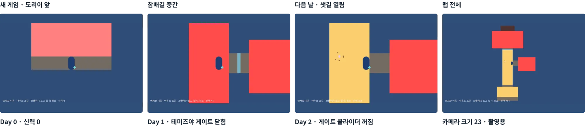
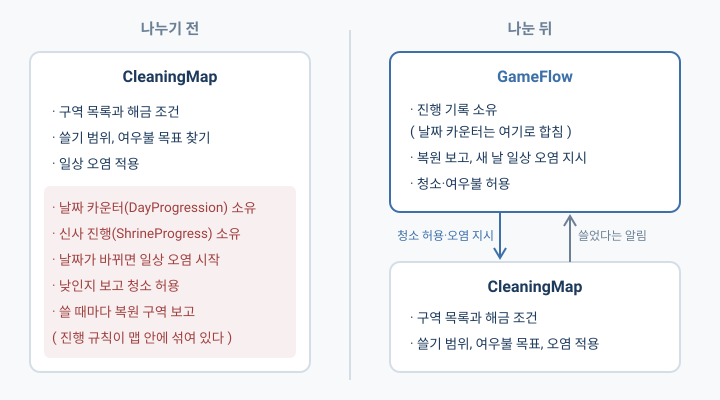

## 개요

옆에서 다른 작업을 돌려 놓고 20분쯤 지났는데 다음 단계가 안 넘어오길래 유니티를 열어 봤더니 아직도 컴파일 중이었다. 컴퓨터가 느린가? 싶었는데 30분이 넘어가니까 이건 뭔가 잘못되고 있다는 느낌이 들었다.

「작은 여우신의 신사 성장기」는 여우신이 빗자루로 낡은 신사를 치워 나가는 2D 게임이다. 이날은 맵 재배치, 따라오는 카메라, 재화와 업그레이드, 밤 대화 화면까지 기능을 한꺼번에 붙인 날이었는데, 정작 지나고 나서 머리에 남은 건 에디터가 멈춰 있던 43분이다. ( Unity 6000.3, C# )

## 25초짜리 게임

구역 두 개( 6×4 격자 )짜리 상태에서 처음부터 엔딩까지 직접 해 보니 25초가 걸렸다. 기획서에 적어 둔 목표가 8~15분이니까 한참 모자라긴 한데, 맵 디자인이나 레벨 설계는 아직 손도 안 댔으니 당연한 숫자였고, 그보다는 기능적으로는 다 완성했구나 하는 쪽에 가까웠다.

남은 일은 구역 수와 배치를 실제 게임 크기에 맞추고, 플레이하면서 덜 지루하게 만드는 쪽이었다. 그래서 구역 두 개짜리 맵을 도리이 → 참배길 → 테미즈야 → 앞마당으로 들어가는 순례형 네 구역으로 다시 깔고, 맵이 커진 만큼 카메라가 여우신을 살짝 늦게 따라오게 붙였다( 해 보니 카메라 느낌은 준수했다 ).

## 짜는 건 맡기고 구조도를 봤다

2편에서 게임 규칙 코드는 내가 직접 쓰기로 했었는데, 이날은 거의 다 AI에게 맡기는 바이브 코딩으로 갔다. 지금까지 짜 온 구조는 이해를 끝냈고, 구조와 작업 흐름만 알고 있으면 나중에 코드를 읽거나 디버깅하는 건 어렵지 않겠다고 판단했다. 시간도 부족했고, 기능 구현은 빨리 끝내 놓고 플레이 경험을 올릴 수 있는 곳에 시간을 쓰고 싶었다.

대신 코드가 쌓일 때마다 Figma에 구현 구조도를 갱신하게 해 두고, 나는 그걸 보면서 결함이나 중복이 없는지만 확인했다. 직접 짜지 않으니까 코드 한 줄 한 줄보다는 "누가 무엇을 들고 있고 누가 누구를 부르는지"를 보는 게 내 일이었다.

그렇게 보다가 걸린 게 두 개 있었다.

하나는 날짜 카운터(`DayProgression`)와 신사 진행 기록(`ShrineProgress`)이 거의 같은 일을 하면서 따로 있었다는 점이다. 신사 진행 기록은 "끝낸 밤이 몇 번인지"로 낮과 밤을 정하는데, 끝낸 밤 수가 곧 날짜니까 날짜를 따로 세는 카운터가 하나 더 있을 이유가 없었다. 그래서 카운터를 지우고 날짜는 끝낸 밤 수에서 읽게 합쳤다.

다른 하나는 맵(`CleaningMap`)이 너무 많은 걸 들고 있다는 점이었다. 원래 맵은 구역 목록, 해금, 쓸기 같은 공간 규칙을 맡는 곳인데, 어느새 날짜 카운터와 진행 기록을 직접 들고 있고, 날짜가 바뀌면 일상 오염을 시작하고, 낮인지 확인해서 청소를 막고, 쓸 때마다 복원 구역을 보고하는 일까지 하고 있었다. 책임을 나눌 수 있는지 검토해 보라고 했더니 진행 규칙만 떼어 낸 `GameFlow`가 새로 생겼다.

나눈 뒤의 맵은 진행 규칙을 모른다. `GameFlow`가 "지금 청소를 받아도 되는지"를 맵에 알려 주고, 맵은 쓸어서 오염이 줄었을 때 "쓸었다"는 알림만 보낸다. 복원 구역 보고는 그 알림을 받은 `GameFlow`가 한다.

## 43분 동안 서로를 기다렸다

그때 화면에는 "Hold on (busy for 43:20)"이 떠 있었다. 다른 작업을 돌리는 동안 20분이 넘게 다음 단계가 안 넘어오길래 유니티를 열어 보니 아직 컴파일 중이었고, 처음엔 컴퓨터가 느린 건가 했다. 그런데 30분이 넘어가니까 이건 아니다 싶어서, 일 좀 제대로 하라고 한 소리 했다.

나중에 원인을 들어 보니 AI가 에디터 자동화 명령 하나 안에서 에셋을 새로고침(`AssetDatabase.Refresh()`)하고 바로 테스트 실행(`TestRunnerApi.Execute()`)을 부른 다음, 테스트가 끝나길 기다리고 있었다. 그 명령 자체가 에디터 메인 스레드에서 돌고 있었는데, 테스트 실행은 메인 스레드가 비어야 진행된다. 명령은 테스트를 기다리고 테스트는 명령이 끝나길 기다리니까, 둘 다 끝까지 움직이지 않는다.

CPU는 거의 놀고 있었는데 바쁨 표시만 계속 떠 있었으니, 무거운 계산이 아니라 서로 기다리는 상태였다고 보는 게 맞을 것 같다( 내부를 직접 들여다본 건 아니고 증상에서 거꾸로 짚은 추정이다 ).

에디터를 강제로 끄고 다시 돌렸더니 Edit Mode 테스트 16개는 전부 통과했고, 유니티가 복구용 씬 사본(`Assets/_Recovery/0.unity`)을 하나 남겨 두었다. 그 뒤로는 테스트를 돌리는 방법을 정해 뒀다. 에디터가 열려 있으면 Test Runner 창에서, 닫혀 있으면 `-batchmode -runTests`로 돌리고, "시작하고 끝날 때까지 기다리는" 작업을 메인 스레드 명령 안에 넣지 않는다.

## 소감

이날은 구조를 이미 이해했다고 판단해서 구현을 빠르게 맡겼고, 대부분은 구조도를 보면서 검토만 했던 터라 기능 하나하나는 사실 크게 기억에 남지 않는다.

남은 건 맡겨 둔 사이에 에디터가 43분 동안 멈춰 있던 장면이다. 30분이 넘어서야 이상하다는 걸 알아챘고, 그 전까지는 애꿎은 내 컴퓨터만 의심하고 있었다.

그래도 기능 구현을 빨리 끝내고 플레이 경험을 올릴 수 있는 쪽에 집중하자는 판단은 그대로다.
