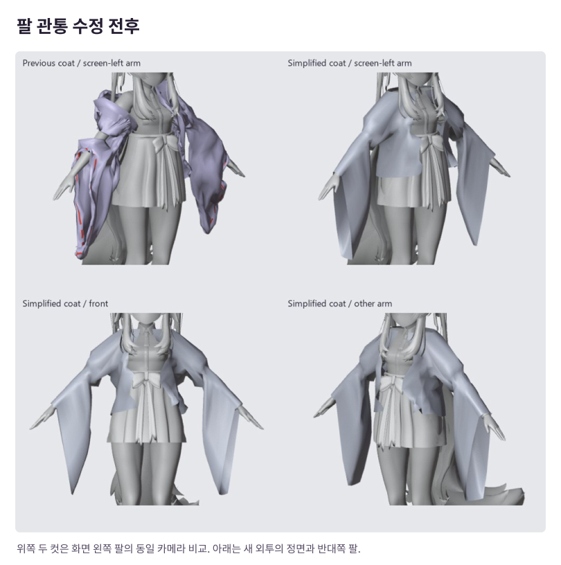

## 개요

시점은 2D로 정했으니 이제 그림만 그리면 되는 줄 알았다. 그런데 막상 직접 그려 보려고 하니까, 앞·뒤·옆 세 장만 그리고 옆은 뒤집어서 재활용하면 된다는 계획이 영 말이 안 되게 느껴졌다. 레퍼런스를 찾아볼수록 필요한 시트와 장면 수가 눈에 들어오는데, 계획표에는 여전히 세 방향이라고 적혀 있었고 AI는 그게 계획대로 잘 되고 있다고 믿고 있었다.

「작은 여우신의 신사 성장기」는 여우신이 빗자루로 낡은 신사를 치워 나가는 2D 게임이다. 코드 쪽은 구역이 열리고 여우불이 돌아다니는 데까지 왔는데, 화면 속 여우신은 아직 파란 캡슐이다.

## 마음은 2.5D, 손은 2D

비스듬히 내려다보는 화면을 만드는 방법은 크게 셋이었다.

- **2.5D**: 바닥을 3D 공간의 XZ 평면에 깔고 카메라를 기울인다. 캐릭터는 그 공간에 세운 2D 그림이고, 높이와 깊이, 가림이 공간에서 자연스럽게 나온다.
- **2D에서 세로만 눌러 그리기**: 게임 좌표는 XY 그대로 두고, 화면에 그릴 때 바닥의 세로 방향만 압축한다. 캐릭터까지 같이 찌그러지지 않게 바닥과 캐릭터의 그리기 규칙을 따로 둬야 하고, 마우스 입력도 거꾸로 풀어 줘야 한다.
- **2D 그대로, 높이는 그림으로**: 바닥 칸은 정사각형으로 두고 건물 앞면, 지붕, 캐릭터 그림으로 높이감을 낸다. 비스듬히 내려다보는 것처럼 보이는 그림이 꼭 바닥을 눌러야 나오는 건 아니다.

어느 쪽이든 격자, 오염, 청소 같은 게임 규칙은 3D로 바꿀 필요가 없었다. 달라지는 건 입력 좌표 변환, 배치, 그리는 순서 같은 화면 쪽이다.

솔직히 마음은 2.5D에 있었다. 보이는 것만 흉내 내는 게 아니라 높이와 가림을 공간 자체가 관리해 주는 방식이라 끌렸다. 하지만 그만큼 그림의 방향, 기울기, 투명 정렬, 입력 투영까지 챙길 게 늘어나고, 지금 구현과 손그림 제작 흐름을 생각하면 2D를 유지하는 게 맞아 보였다.

그래서 XY 좌표계는 그대로 두고, 정사각형 바닥을 기본 시안으로 삼되 세로를 누른 시안도 같이 놓고 비교하기로 했다. 더 좋은 결과를 낼 수 있는 길을 알면서 자원 때문에 줄여야 한다는 게 조금 아쉬웠다.

## 세 방향으로는 안 그려진다

같은 날 캐릭터 그림 방식도 정했다. Clip Studio에서 앞·뒤·옆 세 방향을 통짜 포즈로 그리고, 옆은 좌우 반전해서 쓰고, Unity에서는 스프라이트만 갈아 끼우는 방식이다. 파츠로 잘라서 움직이면 뻣뻣해 보일 것 같아서 통짜로 정했다.

문제는 이 게임 화면이 정면도 아니고 정측면도 아니라는 점이다. 이동과 청소 판정은 XY 두 축으로 하지만, 비스듬히 내려다보는 화면에서 캐릭터가 돌아서면 사선에서는 머리카락, 귀, 꼬리, 소매가 겹치는 모양이 정면과도 측면과도 다르다. 마우스 쪽으로 360° 조준하는 것과 캐릭터 그림이 몇 방향인지는 별개라서, 조준이 자유로울수록 사선에서 보이는 그림이 빠지면 티가 난다. 포즈 레퍼런스로 모아 둔 자료도 45° 간격 여덟 방향으로 돌려 놓은 것들이었다.

그런데도 AI는 세 방향으로 정해 둔 결정을 한 번도 의심하지 않고 계획대로 되고 있다고만 했다. 게임 좌표가 X, Y 두 개뿐이니 몇 장만 그리면 된다는 식으로 계속 돌아오니까 답답해서 말이 꽤 세게 나갔다.

## 이미지 한 장으로 3D를 만들었다는 사례들

그 즈음 SNS에서는 원화 한 장 넣고 3D를 잘 뽑았다는 사례가 계속 올라오고 있었다. 저건 어떻게 한 건지 궁금해서 분석을 부탁했는데, 들어 보니 도구 하나가 한 번에 다 해 준 게 아니었다.

- **이미지→3D 생성기**( Tripo 같은 것 ): 원화를 보고 초기 메쉬 후보를 만든다. 사람 몸이나 머리카락처럼 유기적인 형태의 출발점을 얻는 용도다.
- **Blender MCP, Blender Python**: 만들어진 메쉬를 검사하고 고치고, 조립하고, 여러 각도에서 렌더한다.

정면 렌더가 그럴듯해 보여도 측면과 후면, UV, 폴리곤 정리, 뼈대 가중치, 애니메이션에서 문제가 남을 수 있어서, 비슷해 보이는 성공 사례라도 처음 형태를 누가 만들었는지부터 나눠 봐야 했다.

이걸 듣고, 툴 하나로 제로샷에 끝내는 게 아니라 역할을 제대로 나눠서 만든다는 걸 알게 됐고, 각 도구의 장점을 살려서 역할을 나누는 게 중요하다는 걸 다시 생각해 보게 됐다.

## 진행 방향성

3D 모델을 최종 화면에 그대로 쓰려는 게 아니라, 여덟 방향과 동작에서 형태가 흔들리지 않는 기준을 얻고, 그걸 바탕으로 Clip Studio에서 다듬어 직접 그림을 그리는 게 목적이다. 그래서 사실적인 해부학보다 고정된 게임 카메라에서 실루엣과 비율, 캐릭터 인상이 맞는 게 더 중요했다.

이미 갖고 있던 베이스 모델 MANUKA로 체형을 원화 비율에 최대한 맞추고, 의상은 실루엣이 비슷한 무료 에셋을 받아 고치거나 없으면 직접 만들고, 그 과정의 수정과 다각도 검사는 Blender MCP로 돌리는 구성이다. 옷 만드는 도구로 ClothCode도 같이 봤는데, 필수로 두지는 않고 넓은 소매처럼 봉제와 늘어짐이 중요한 부분에서 다른 방법( Blender 기본 Cloth, Data Transfer, Python 직접 제작 )과 비교해 보기로 했다.

## 옷을 파츠로 자르면 옷이 안 된다

이 과정에서 제일 어이없었던 게 의상이었다. 파츠를 나눠서 만들어 보라고 했더니, 사람이면 당연히 구분하는 옷의 구조나 큰 덩어리, 흐름을 하나도 모르는 것처럼 쪼개 놓거나 실루엣을 자기 마음대로 만들어 놨다. 결과물은 쳐다보기도 힘들 정도였다.

나중에 정리한 기준은 "파츠를 많이 나누기" 대신 표현을 층으로 나누는 것이었다.

| 층 | 맡는 것 |
|---|---|
| 메쉬 | 소매 폭과 처짐, 옷깃, 치마 퍼짐, 옷자락 겹침처럼 외곽 실루엣과 부피를 바꾸는 것 |
| 메쉬 변형·천 시뮬레이션 | 팔꿈치 눌림, 허리 당김, 소매 접힘 같은 큰 주름 |
| UV·텍스처 | 색 구분, 무늬, 재봉선, 얕은 주름과 작은 명암 |
| 셀 셰이딩·2D 리터치 | 원화 특유의 선, 과장된 면 분할, 얼굴과 의상 인상 보정 |

천이 이어져야 하는 부위를 딱딱한 조각으로 잘라 붙이면 갑옷처럼 보이거나, 팔을 움직일 때 틈이 벌어지고 몸을 뚫고 나온다. 리본, 끈, 방울처럼 원래 따로 달린 장식만 따로 만드는 게 맞다.

치마는 무료 의상 에셋( ruruku의 Milk RE183 )의 하카마 윗부분을 가져와 원화 비율에 맞췄고, 문제의 신사풍 외투는 열린 앞섶, 등판, 넓게 처지는 소매, 손목 입구를 이어진 한 겹으로 다시 만들었다. 삼각형 수는 6,574개에서 1,648개로 줄었고, 원화처럼 양팔을 44° 든 자세에서는 24프레임 내내 외투가 피부를 뚫는 곳이 없었다.

## 아직 끝나지 않았다

몸도 한 번에 맞춰지지 않았다. 원화 비율에 맞춰 종아리를 8% 줄이고 걷기 동작에서 막히는 데가 없는 것까지는 확인했는데, 몸통은 세 번( v03~v05 ) 줄여 봤다가 전부 접고 원래 후보( v02 )로 돌아갔다. 원화의 치마 경계와 모델의 의상 경계를 비교하고 있었기 때문에, 몸 기준점으로 다시 재 보니 줄일 근거가 없었다.

뒷머리, 꼬리, 귀, 치마, 반팔 소매까지는 승인했고 외투는 아직 검토 중이다. 팔을 고정한 자세에서 관통이 없다는 것까지만 봤고, 팔을 움직이는 자세나 걷기, 빗자루질에서 옷이 어떻게 움직이는지는 아직 못 봤다. 여덟 방향 렌더를 뽑아서 실제로 게임에 몇 방향을 넣을지, 그 렌더를 어디까지 써도 되는지도 그다음 일이다.

## 소감

제일 기억에 남는 건 이게 아직도 진행 중이라는 무서운 이야기다. 세 장으로는 안 된다는 데서 출발해서 그림의 기준을 잡으려고 3D 모델을 시작했는데, 지금은 외투 하나를 붙잡고 있다.

2.5D를 접은 건 지금도 조금 아쉽다. 그래도 남이 올린 사례를 뜯어보면서, 도구 하나로 한 번에 끝내는 게 아니라 역할을 나눠서 각자의 장점을 살리는 게 중요하다는 걸 다시 생각해 본 건 이번에 얻은 것 같다.
