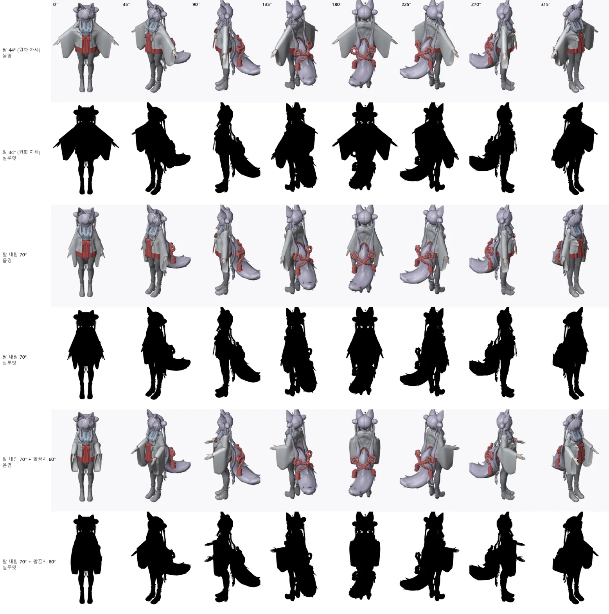
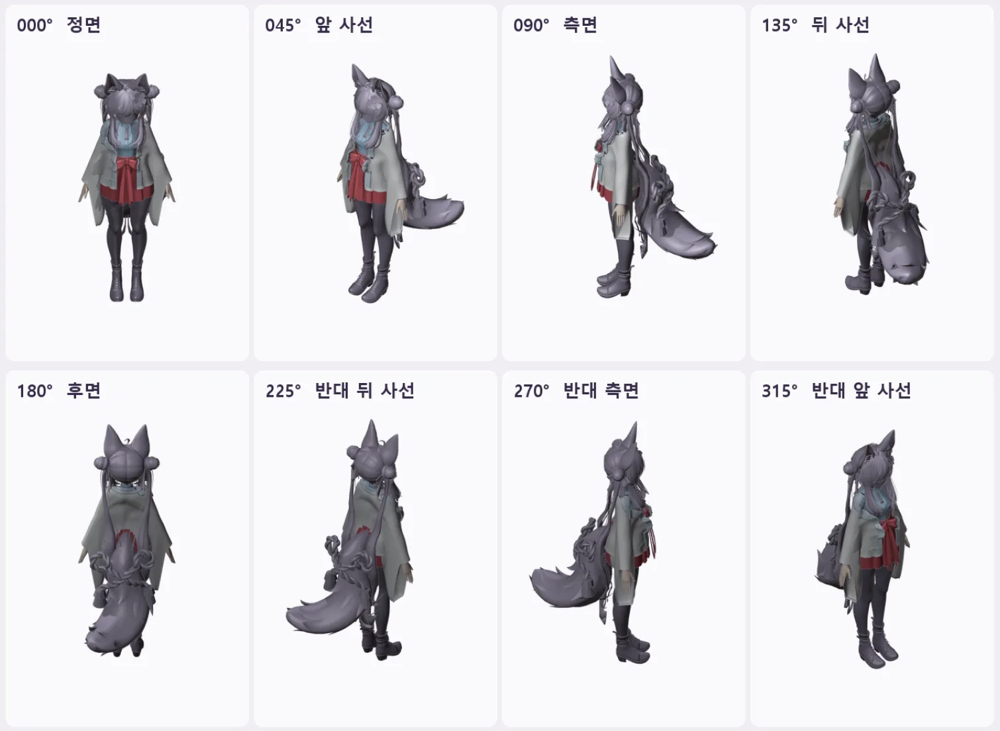
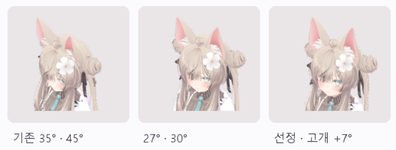
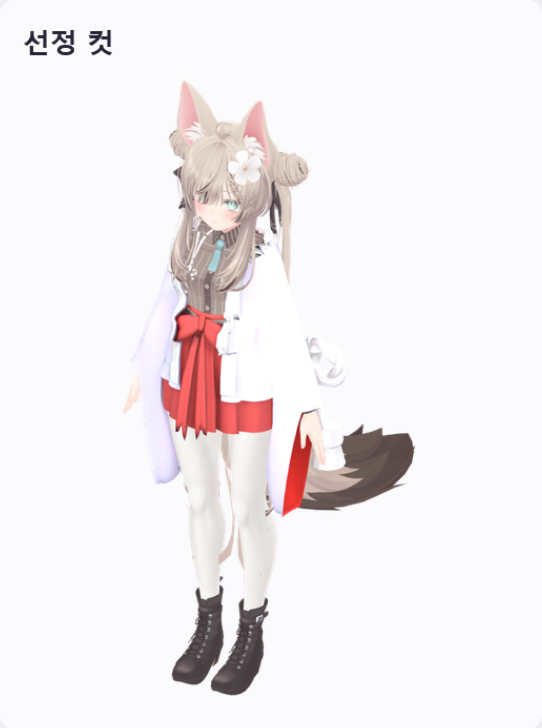
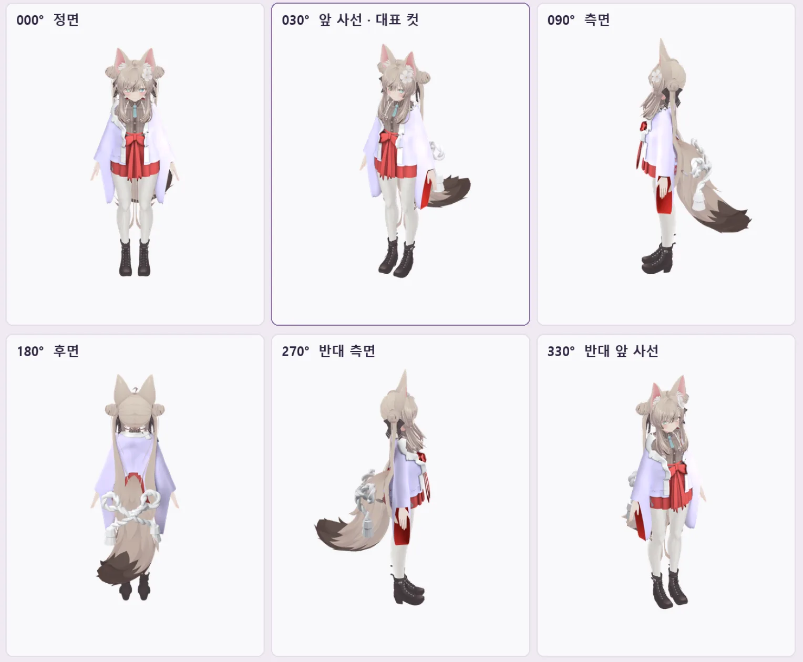
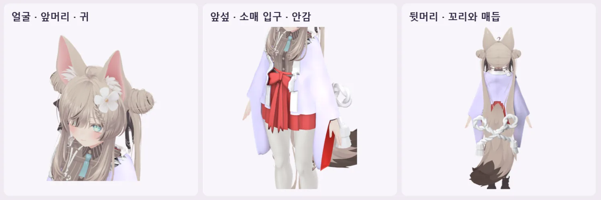
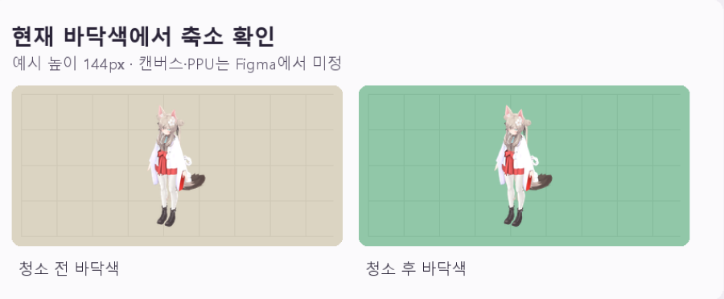
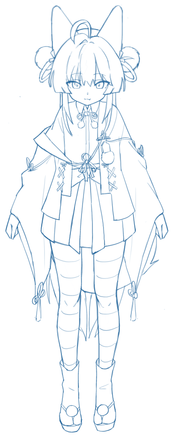

## 개요

지난 글은 신사풍 외투 하나를 붙잡고 있다는 이야기로 끝났다. 그 외투를 채택하고 나니 이제 정말 그림을 그릴 차례였고, 그 전에 일반 대기 자세를 카메라 각도와 방향별로 뽑아 달라고 했다. 그런데 처음 받은 시트를 보고는 이게 맞나 싶었다. 형태는 다 맞는데 캐릭터의 매력이 하나도 보이지 않았다.

「작은 여우신의 신사 성장기」는 여우신이 빗자루로 낡은 신사를 치워 나가는 2D 게임이다. 3D 모델은 화면에 그대로 쓰려는 게 아니라, 여러 방향에서 형태가 흔들리지 않게 그림을 그릴 때 기준으로 삼으려고 만들고 있다.

## 여덟 방향이 다 있는데 누군지가 안 보인다

외투를 고치는 동안 보던 시트는 이런 모양이었다. 위에서 35° 내려다보는 정사영 카메라로 정면부터 45°씩 돌려 가며 여덟 방향을 찍고, 팔 자세 세 개를 각각 음영과 검은 실루엣으로 뽑았다. 그때 하던 일이 옷이 몸을 뚫고 나오는지, 외곽이 원화와 맞는지를 보는 것이었기 때문에 이런 시트로 충분했다.

처음 받은 대기 자세 시트도 같은 카메라였다. 양팔을 70° 내린 자세를 같은 회색 톤으로 렌더해서, 외투와 소매, 뒷머리, 꼬리의 외곽이 방향마다 어떻게 바뀌는지 비교하기 좋았다.

문제는 이제 이걸 보고 그림을 그려야 한다는 점이었다. 외투가 어디로 벌어지는지는 다 보이는데 얼굴은 머리카락과 귀 사이에 묻혀 있어서, 여덟 장을 다 넘겨도 이 캐릭터가 어떤 인상인지가 잡히지 않았다. 그림으로 옮길 때 가장 살려야 하는 게 캐릭터의 인상인데, 그게 실루엣 속에 묻혀 버린 게 제일 걸렸다.

## 얼굴이 차지하는 몫이 너무 작았다

보면서 든 생각은 단순했다. 화면 안에서 얼굴이 차지하는 비율이 너무 작다는 것이었다.

그래서 게임 화면과 지금 기획에 맞으면서 인상이 가장 잘 드러나는 각도를 골라 달라고 맡겼다. 같은 자세로 35°, 27°, 20°를 비교해서 위에서 27° 내려다보는 정사영에, 정면에서 30° 돌린 앞 사선, 고개를 7°쯤 들어 올린 컷을 대표 컷으로 정했고, 이번에는 저장해 둔 텍스처와 재질도 입혀서 찍었다.

다른 게임들은 이런 걸 어떻게 잡는지도 물어봤는데, 돌아온 설명보다는 다시 찍어 온 사진을 보고 납득이 됐다.

## 그릴 때 보는 컷은 따로 있다

최종으로 받은 건 같은 카메라 크기로 찍은 투명 배경 전신 6장( 0°, 30°, 90°, 180°, 270°, 330° )과 부분 확대 3장이다. 카메라 크기를 고정해 둬서 방향을 바꿔도 키와 비율을 같은 자로 비교할 수 있다.

전신 컷에서는 작게 뭉개지는 부분은 확대 컷으로 따로 본다. 얼굴과 앞머리, 귀가 한 장이고, 앞섶과 소매 입구, 안감이 한 장, 뒷머리와 꼬리, 매듭이 한 장이다.

게임 화면 크기로 줄이면 또 다르게 보인다. 높이 144px짜리 예시를 청소 전후 바닥색 위에 올려 보면, 눈보다 귀와 꼬리, 흰 소매와 붉은 치마가 먼저 들어온다( 게임에서 실제로 몇 px로 보일지는 아직 정하지 않아서 어디까지나 예시 크기다 ).

## 소감

이 레퍼런스를 보고 이제 그릴 수 있겠다고 판단해서, 지금은 직접 그림을 그리고 있다.

사실 모델링 단계에서 원본의 장식들을 더 디테일하게 붙이고 넘어가고 싶었는데, 들이는 시간에 비해 효율이 안 나올 것 같아서 그 부분은 내 그림에 맡기기로 했다. 그게 조금 걸리긴 하지만 아직까지는 문제없어 보인다.
