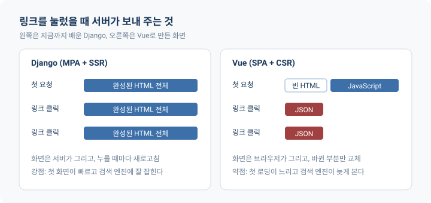
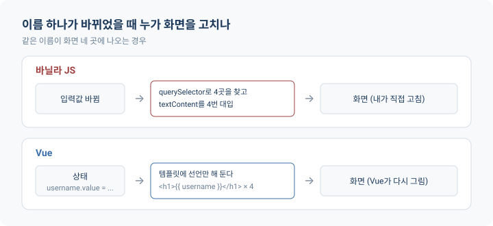

## 개요

같은 사용자 이름이 화면 네 곳에 찍혀 있다고 해 보자. 인사말, 친구 목록, 알림 목록, 친구 요청 목록에 전부 이름이 들어가 있어서, 입력창에서 이름을 바꾸면 네 곳이 같이 바뀌어야 한다. 바닐라 JS로 이걸 하려면 `querySelector`로 요소를 하나씩 찾고 `textContent`를 하나씩 다시 넣어 줘야 하는데, Vue로 같은 화면을 만들면 그 코드가 한 줄도 남지 않고 `username.value`만 바꾸면 네 곳이 함께 바뀐다.

이게 되려면 두 가지가 필요하다. 화면을 그리는 일이 서버에서 브라우저로 넘어와야 하고( SPA와 CSR ), 브라우저 쪽에는 데이터가 바뀌는 걸 지켜보다가 화면을 다시 그려 주는 무언가가 있어야 한다( Vue의 반응성 ).

---

## 1. 프레임워크 없이 쓰면 같은 코드가 이름 수만큼 늘어난다

앞의 상황을 바닐라 JS로 그대로 옮기면 이렇게 된다.

```html
<!-- 이름이 들어갈 자리 네 곳 -->
<input type="text" id="inputArea">                   <!-- 이름 입력창 -->
<h1>안녕하세요 <span id="username1"></span></h1>      <!-- 자리 1: 인사말 -->
<div><span id="username2"></span>님의 친구 목록</div>   <!-- 자리 2 -->
<div><span id="username3"></span>님의 알림 목록</div>   <!-- 자리 3 -->
<div><span id="username4"></span>님의 친구 요청 목록</div> <!-- 자리 4 -->
```

```javascript
const inputArea = document.querySelector('#inputArea')  // 입력창 찾기
const username1 = document.querySelector('#username1')  // 자리 1 찾기
const username2 = document.querySelector('#username2')  // 자리 2 찾기
const username3 = document.querySelector('#username3')  // 자리 3 찾기
const username4 = document.querySelector('#username4')  // 자리 4 찾기

inputArea.addEventListener('input', function (e) {      // 입력할 때마다
  username1.textContent = e.target.value                 // 자리 1 다시 쓰기
  username2.textContent = e.target.value                 // 자리 2 다시 쓰기
  username3.textContent = e.target.value                 // 자리 3 다시 쓰기
  username4.textContent = e.target.value                 // 자리 4 다시 쓰기
})
```

이름이 나오는 곳이 열 군데로 늘면 찾는 줄과 대입하는 줄도 열 줄씩 늘어나고, 하나라도 빠뜨리면 그 자리만 옛 이름으로 남는다. 요즘 웹은 문서를 읽기만 하는 곳이 아니라 음악을 틀고 채팅을 하는 애플리케이션에 가까워서, 이런 "데이터 하나에 화면 여러 곳"이 계속 쌓인다.

클라이언트 사이드 프레임워크( Vue, React, Angular )는 이 반복을 대신 맡아 주는 JavaScript 코드 뼈대다. 개발자는 "이 데이터가 이 자리에 나온다"까지만 적고, 데이터가 바뀌었을 때 화면 어디를 고칠지는 프레임워크가 챙긴다.

## 2. 화면을 그리는 곳이 서버에서 브라우저로 옮겨 왔다

지금까지 수업에서 쓴 Django는 링크를 누를 때마다 서버가 템플릿으로 완성된 HTML을 만들어서 통째로 보냈다. Vue로 만든 화면은 처음에 거의 빈 HTML과 JavaScript 파일만 받고, 그 뒤로는 서버에 필요한 데이터만 JSON으로 요청해서 브라우저가 직접 화면을 그린다.



여기서 두 용어가 나온다.

- **SPA( Single Page Application )** — HTML 파일 하나 위에서 동작하는 앱이다. 진짜로 페이지를 옮겨 가는 일 없이, JavaScript가 DOM에서 필요한 부분만 갈아 끼운다.
- **CSR( Client Side Rendering )** — 그 갈아 끼우는 일을 브라우저( 클라이언트 )가 맡는 방식이다. 서버는 빈 HTML과 JS를 주고, 브라우저가 JS를 실행해 데이터를 비동기로 받아 와서 페이지를 완성한다.

Google 지도나 Instagram에서 화면을 옮겨 다녀도 새로고침이 없는 이유가 이것이다. 서버는 매번 HTML 전체를 만들 필요 없이 데이터만 보내면 되니까 부하도 줄고, 화면은 프론트엔드가 맡고 데이터는 백엔드가 맡는 식으로 역할도 깔끔하게 나뉜다. 그래서 Vue와 붙여 쓸 Django는 HTML 대신 JSON만 응답하는 DRF( Django REST Framework )로 바뀐다고 한다.

단점은 두 가지가 남는다. 하나는 첫 로딩이 느리다는 것인데, JS를 다운로드하고 실행하기 전까지는 화면이 빈 채로 있기 때문이다. 다른 하나는 검색 엔진 최적화( SEO )로, 검색 엔진이 HTML을 읽으러 왔을 때 콘텐츠가 아직 그려져 있지 않을 수 있다. Google 검색 로봇은 JS를 실행해서 CSR 페이지도 읽지만 반영이 늦을 수 있고, 메신저의 링크 미리보기는 대부분 JS를 실행하지 않아서 CSR 페이지 링크를 공유하면 제목과 이미지가 빈 채로 나올 수 있다.

CSR과 서버에서 HTML을 그려 보내는 SSR은 둘 중 하나만 고르는 문제가 아니고, 서비스 목적에 따라 섞어 쓴다. Vue 쪽의 Nuxt, React 쪽의 Next.js가 SPA를 유지하면서 첫 화면을 서버에서 그려 주는 프레임워크다.

## 3. Vue에는 "어디에 무엇이 나오는지"만 적는다

Vue는 Evan You가 2014년에 발표한 프레임워크고, 지금은 Vue 3가 기본이다( 2020년 9월 출시, 2022년 2월부터 기본 버전 ). Vue 2는 2023년 12월 31일에 지원이 끝났기 때문에, 검색하다가 `v2.vuejs.org` 문서에 들어가면 지금 문법과 다른 내용을 보게 된다. 공식 문서는 Vue 3 쪽만 보면 된다.

Vue의 핵심 기능은 두 가지다.

- **선언적 렌더링** — HTML을 확장한 템플릿 문법으로 "이 자리에는 이 데이터가 나온다"를 적는다.
- **반응성** — 데이터가 바뀌는 걸 Vue가 추적하다가, 바뀌면 DOM을 자동으로 고친다.



1절의 화면을 Vue로 다시 쓰면 이렇다. 


```html
<div id="app">
  <input type="text" v-on:input="onInput">   <!-- 입력할 때마다 onInput 호출 -->
  <h1>안녕하세요 {{ username }}</h1>         <!-- 자리 1 -->
  <div>{{ username }}님의 친구 목록</div>     <!-- 자리 2 -->
  <div>{{ username }}님의 알림 목록</div>     <!-- 자리 3 -->
  <div>{{ username }}님의 친구 요청 목록</div> <!-- 자리 4 -->
</div>

<script src="https://unpkg.com/vue@3/dist/vue.global.js"></script>
<script>
  const { createApp, ref } = Vue                 // CDN이 만든 전역 Vue에서 꺼내기

  const app = createApp({                        // 루트 컴포넌트를 넘겨 앱 만들기
    setup() {                                    // 화면을 그리기 전에 한 번 실행
      const username = ref('Unknown User')       // 반응형 상태, 데이터는 여기 한 곳에만
      const onInput = function (event) {         // input 이벤트 처리 함수
        username.value = event.target.value      // 데이터만 바꾼다, DOM은 건드리지 않음
      }
      return { username, onInput }               // 템플릿에서 쓸 것만 내보낸다
    }
  })

  app.mount('#app')                              // id가 app인 요소에 앱 연결
</script>
```


`querySelector` 다섯 번과 `textContent` 대입 여덟 번이 전부 사라졌다. 이름이 나오는 자리가 열 군데로 늘어도 템플릿에 `{{ username }}`만 더 적으면 되고, JS 코드는 그대로다.

코드의 흐름을 짚으면 이렇다.

- `createApp()`에 넘기는 객체가 루트 컴포넌트다. 앱에는 다른 컴포넌트를 품는 최상위 컴포넌트가 하나 있어야 한다.
- `setup()`은 컴포넌트가 동작하기 전에 미리 준비하는 함수다. 여기서 데이터와 함수를 만들고, **`return`한 것만** 템플릿에서 쓸 수 있다. return하지 않은 변수를 템플릿에 쓰면 화면에는 아무것도 안 나오고 콘솔에 경고가 뜬다.
- `{{ }}`( 콧수염 문법, Mustache syntax ) 안에는 변수 이름뿐 아니라 값이 되는 JS 표현식 하나를 쓸 수 있다. `{{ message.split('').reverse().join('') }}`처럼 쓰면 글자를 뒤집어서 보여 준다.
- `v-on:input`, `v-on:click`처럼 `v-on` 디렉티브로 DOM 이벤트를 받는다.
- `mount()`는 만든 앱을 실제 HTML 요소에 붙인다. 앱 하나에 한 번만 호출할 수 있다.

## 4. ref는 값을 상자에 담아야 변화를 알 수 있다

`username`을 그냥 `let username = 'Unknown User'`로 두면 안 되나? 싶었는데, 안 되는 이유가 있다. JavaScript에는 일반 변수의 값을 읽거나 바꾸는 순간을 가로챌 방법이 없다. 그래서 Vue는 값을 `.value` 속성을 가진 객체로 한 번 감싸고( 래핑 ), 이 `.value`를 누가 읽고 누가 바꾸는지를 지켜본다. 렌더링할 때 읽힌 ref를 기억해 뒀다가 그 ref의 `.value`가 바뀌면 그걸 쓰는 컴포넌트를 다시 그리는 방식이다.

`ref()`가 돌려주는 게 그 상자다.

```javascript
const message = ref('Hello vue!')  // 'Hello vue!'를 상자에 담는다
console.log(message)               // ref 객체 (상자 자체)
console.log(message.value)         // Hello vue! (상자 안의 값)
```

스크립트에서는 항상 `.value`로 상자를 열어서 읽고 써야 한다. `message = '반가워요'`처럼 쓰면 상자 자체를 갈아 끼우려는 거라서 Vue가 알아채지 못하고, 애초에 `const`라 에러가 난다. 템플릿에서는 Vue가 상자를 알아서 열어 주기 때문에( 자동 언래핑 ) `{{ message.value }}`가 아니라 `{{ message }}`로 쓴다.

일반 변수와 ref를 나란히 두면 차이가 바로 보인다.


```html
<div id="app">
  <p>반응형 변수: {{ reactiveValue }}</p>  <!-- 누를 때마다 1, 2, 3... -->
  <p>일반 변수: {{ normalValue }}</p>      <!-- 계속 0 -->
  <button v-on:click="updateValues">값 업데이트</button>
</div>

<script>
  const { createApp, ref } = Vue

  createApp({
    setup() {
      const reactiveValue = ref(0)              // 상자에 담은 값
      let normalValue = 0                       // 그냥 숫자
      const updateValues = function () {
        reactiveValue.value++                   // Vue가 변화를 감지
        normalValue++                           // 값은 오르지만 Vue는 모름
        console.log(normalValue)                // 콘솔에는 1, 2, 3...이 찍힌다
      }
      return { reactiveValue, normalValue, updateValues }  // normalValue는 0이 복사돼 넘어감
    }
  }).mount('#app')
</script>
```


버튼을 누르면 `reactiveValue`가 바뀐 걸 Vue가 감지해서 화면을 다시 그린다. 그런데도 일반 변수 자리는 0으로 남는다. `setup()`이 `return`할 때 `normalValue`는 그 순간의 값 0이 복사돼서 넘어갔고, 템플릿은 그 복사본을 계속 보고 있기 때문이다. 콘솔로 찍어 보면 `normalValue` 자체는 1, 2, 3으로 잘 오르고 있어서, 값이 안 바뀐 게 아니라 화면이 그 변수를 모르는 상태다.

## 5. 화면은 컴포넌트를 조립해서 만든다

마지막으로 나온 개념이 컴포넌트다. 컴포넌트는 재사용할 수 있는 코드 블록으로, UI를 독립적인 조각으로 나눠서 각 조각을 따로 다룰 수 있게 해 준다. 웹 서비스 화면을 보면 사이드바, 게시물 카드, 친구 목록처럼 같은 모양이 반복되는 덩어리가 있는데, 이것들을 컴포넌트로 만들어 조립하면 앱은 자연스럽게 `Root` 아래에 `Header`, `Main`, `Aside`가 있고 `Main` 아래에 `Article`이 여러 개 붙는 트리 모양이 된다.

오늘 쓴 `createApp()`의 루트 컴포넌트가 그 트리의 맨 위다. 아직은 컴포넌트가 하나뿐이라 트리라고 부를 것도 없지만, `.vue` 파일 여러 개로 나눠 쓰는 건 NPM( Vite ) 방식으로 넘어가는 SFC 수업부터 다룬다고 한다.

## 소감

웹으로 개발을 많이 해 본 편이 아니라서 DOM을 직접 고치다가 고생한 기억은 따로 없었다. 그래도 수업 예제를 직접 돌려 보니, 셀렉터로 요소를 하나하나 찾아 수정하는 것보다 훨씬 유동적인 느낌이 들어서 괜찮다는 인상이 남았다.

---

## 더 읽어볼 만한 것

- [Vue 공식 문서 - 소개](https://vuejs.org/guide/introduction.html)
- [Vue 공식 문서 - 반응성 기초](https://vuejs.org/guide/essentials/reactivity-fundamentals.html)
- [Vue 2 지원 종료 안내](https://v2.vuejs.org/eol/)
